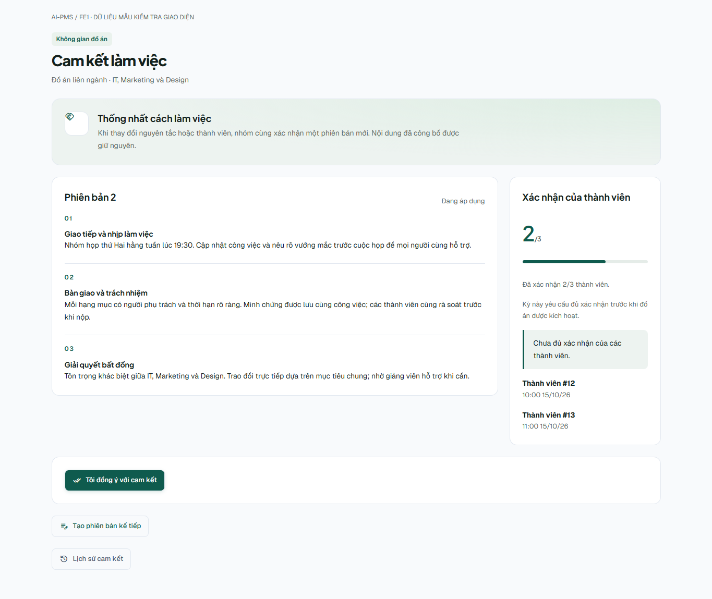
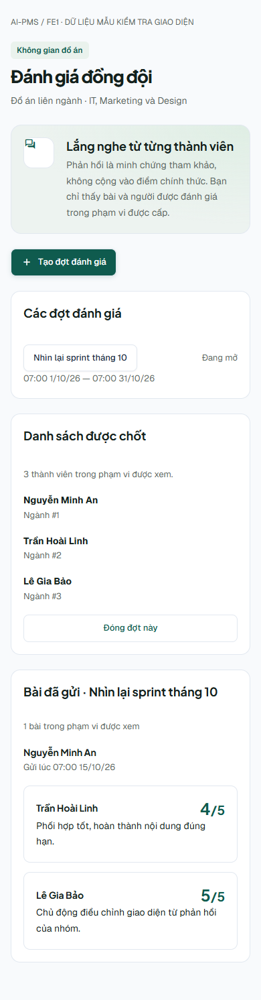

# FE1 — Cam kết, phản hồi và cộng tác sinh viên

## Phạm vi bàn giao

- Nhánh: `feat/fe1-student-collaboration-20261015`.
- Baseline FE: `origin/develop@1db4528` (PR #87).
- Đối chiếu BE source `090f93d` và Swagger staging ngày 15/10/2026.
- Không sửa router/sidebar/auth/config chung do FE2 sở hữu. Không sửa các module FE2/FE3 đang được hai thành viên thực hiện.
- Trạng thái: code FE1 và kiểm thử component/HTTP/build đạt; chưa chứng nhận `INTEGRATED_READY` hay browser lifecycle trên dữ liệu thật.

## Phần đã triển khai

| Nhóm | Kết quả | Trạng thái |
| --- | --- | --- |
| Working Agreement | Leader soạn/sửa draft, công bố có xác nhận, thành viên chấp nhận đúng phiên bản, lịch sử phân trang, phiên bản kế tiếp; Primary/khoa có component chỉ đọc | DELIVERED code; route standalone khoa/Primary chờ FE2 |
| Agreement trước ACTIVE | Panel tại `/project/status` để nhóm đáp ứng policy trước activation. Lấy capability từ BE, không suy quyền từ role | DELIVERED entry hiện có; FE2 cần di chuyển guard của `/project/agreement` |
| Peer | Primary tạo/đóng đợt, roster snapshot, submissions đã gửi phân trang; khoa chỉ đọc dữ liệu BE lọc; sinh viên chọn đợt cũ và xem bài mình | DELIVERED code; route khoa/Primary chờ FE2 |
| Điểm tuần | Sinh viên đọc bản SUBMITTED của mình; Primary xem lịch sử, tạo revision từ bản đã nộp; tải roster khi workspace không cung cấp team | DELIVERED code; route student standalone chờ FE2 |
| Sprint | Sửa `PLANNING` thành `PLANNED`; tải đủ trang trước tính tổng/carryover; chặn board vượt giới hạn; chỉ chuyển carryover sang PLANNED; giữ form khi lỗi; chặn click trùng; quản lý theo capability | DELIVERED |
| Xung đột | Dùng token mới sau save trước submit; 409 tải lại và giữ riêng nội dung chưa lưu; không tự replay mutation; hỏi trước khi chuyển tuần/đợt có bản chưa lưu | DELIVERED |
| Student result / phúc khảo | Giữ phần sở hữu FE1; chờ component/contract phúc khảo và revision resolver từ FE2 để nối, không dựng contract dự kiến khác | DEPENDENCY FE2 |
| Chat/meeting/team/qualification/file/lifecycle | Bộ regression hiện có chạy đạt; không đổi các provider hoặc tạo fixture nghiệp vụ trong lượt này | PARTIAL: còn browser/API thật nhiều role |

## Điểm vào hiện dùng được

Khi các flag tương ứng đã bật trong môi trường chạy:

- Student `/project/status`: mở **Cam kết nhóm**, dùng được trước ACTIVE theo capability BE.
- Student workspace: panel **Cam kết & phản hồi**, gồm cam kết và lịch sử phản hồi tuần của chính mình.
- Student `/project/agreement`: trang soạn/publish/accept/history đầy đủ; guard chung hiện vẫn ACTIVE-only.
- Student `/project/peer-evaluation`: draft/submit/lịch sử bài mình. Đổi đợt hỏi xác nhận nếu có nội dung chưa lưu.
- Primary `/supervisor/projects/:projectId/workspace`: panel cam kết chỉ đọc và quản lý peer.
- Primary `/supervisor/projects/:projectId/weekly-assessments`: chấm và lịch sử/revision.
- Task board → **Sprint & Backlog**: trạng thái theo BE, scope dữ liệu BE, không tính carryover chỉ từ trang đầu.

Các panel đã mở giữ mounted khi thu gọn/chuyển panel để không mất nội dung đang soạn. Khi chuyển sang project khác, key theo project phải reset state.

## FE2 cần nối route/menu/guard

Các đường dẫn sau là đề xuất tích hợp, chưa được đăng ký bởi nhánh FE1:

| Route | Export/component | Điều kiện |
| --- | --- | --- |
| `/project/weekly-assessments` | `StudentWeeklyAssessmentsPage`, `features/weekly-assessments/WeeklyAssessmentHistory.tsx` | Student, có project/profile; chỉ SUBMITTED của mình |
| `/supervisor/projects/:projectId/peer-evaluations` | `SupervisorPeerRoundsPage`, `features/peer-eval/PeerRoundManagementPage.tsx` | Execution context chứa project và assignment Primary; create chỉ ACTIVE/FINAL_SUBMISSION |
| `/department/projects/:projectId/peer-evaluations` | `DepartmentPeerEvaluationsPage`, cùng file | Department scope; không mở quyền Admin/Mentor/evaluator; BE lọc target ngành |
| `/supervisor/projects/:projectId/agreement` | `ProjectAgreementReadPage`, `features/working-agreement/WorkingAgreementWorkspace.tsx` | Primary được BE cho đọc; không có nút ký/soạn |
| `/department/projects/:projectId/agreement` | `ProjectAgreementReadPage`, cùng file | Khoa đúng scope, chỉ đọc |

FE2 di chuyển `/project/agreement` ra khỏi `ActiveStudentProjectRoute`; giữ kiểm tra session/student/project và để capability BE quyết định mutation. Cập nhật registry/menu cùng lúc. Đừng mở toàn bộ execution routes cho trạng thái chưa ACTIVE chỉ để nối một màn.

Peer/weekly history cần được xem ở trạng thái BE cho phép; guard FINAL_SUBMISSION/COMPLETED/ARCHIVED phải xét riêng quyền đọc, không mở mutation thông thường. Sau khi FE2 đưa component phúc khảo thật, FE1 mới nối vào `StudentProjectResultPage`.

## Contract và quy tắc tích hợp

- Flags hiện có: `VITE_ENABLE_WORKING_AGREEMENT`, `VITE_ENABLE_PEER_EVAL`, `VITE_ENABLE_WEEKLY_ASSESSMENT`, `VITE_ENABLE_JIRA_SPRINT`. Nhánh này không thay `.env` hoặc giá trị mặc định chung.
- Agreement: draft đầu/kế tiếp dùng `expectedLatestVersion`; sửa DRAFT thêm token của draft. Publish/accept dùng `{agreementId, concurrencyToken}`. Draft kế tiếp không thay active agreement cho tới khi publish.
- Peer: ngày nhập theo timezone thiết bị, gửi ISO UTC. Tạo/đóng do Primary active; canManage/canSubmit và roster lấy từ response. Student chỉ gọi `/mine`, không gọi endpoint submissions của reviewer.
- Weekly: latest/history được lọc project/student/week; response sai scope bị chặn hiển thị. `0` là điểm thật, null là chưa chấm. SUBMITTED chỉ tạo phiên bản kế tiếp có lý do, không ghi đè. Điểm tham khảo không đi vào result chính thức.
- Sprint: giới hạn FE 500 sprint/2.000 task, tải 50 sprint/100 task mỗi trang. Nếu total thay đổi/trùng ID/thiếu dòng thì chặn thao tác hoàn tất và yêu cầu tải lại. BE vẫn kiểm tra token và đủ carryover trong transaction; FE không bảo đảm atomic snapshot chỉ từ paginated GET.
- `create_task` hiện dùng cùng `ProjectExecutionAuthority.IsManagerAsync` với sprint BE; FE dùng capability đó cho create/board edit, và canStart/canComplete riêng của sprint. Nếu BE tách quyền sprint sau này phải đổi adapter, không fallback theo role.
- 401: hết phiên; 403: sai quyền; 404: không có/tính năng tắt; 409: đối chiếu dữ liệu mới; 400/422: kiểm tra nội dung/thời gian/điều kiện. Không hiển thị raw lỗi server.

## Kiểm chứng đã chạy

- `pnpm typecheck`: đạt.
- `pnpm build`: đạt; còn cảnh báo bundle LiveKit >500 kB của ứng dụng.
- Toàn bộ Vitest: **232 file, 1.197 test đạt** (15/10/2026). Bao gồm regression chat, meeting, task, team, qualification và student pages hiện có; đây là unit/component/HTTP mocked tests.
- `pnpm lint`: exit 0, vẫn có warnings React trong repo và async-loading effects; không tuyên bố lint warnings-as-errors đạt.
- HTTP contract tests đi qua HTTP client thật với fetch giả lập: verb, route, paging, auth header và token; không replay publish khi 409.
- Swagger staging read-only: xác nhận draft/publish/history agreement; create/list/close peer round; scoped peer submissions; weekly history routes tồn tại.
- Visual QA bằng Chromium/Edge headless, component thật + API giả lập: agreement/peer/weekly ở **1365px và 390px**, không overflow ngang hoặc page error; mở editor và lưu successor draft. Ảnh dùng hoàn toàn dữ liệu tổng hợp, không phải sinh viên thật.

## Nghiệm thu tích hợp tiếp theo

1. Sau khi route/adapter của FE2–FE3 sẵn sàng, dùng fixture có nhãn test cho đơn ngành IT và liên ngành IT+Marketing+Design. Ghi project/user/version IDs cho từng luồng.
2. Leader soạn/publish, từng member accept; policy bắt buộc trước ACTIVE, roster đổi và hai tab dùng token cũ. Primary/khoa chỉ đọc đúng scope.
3. Primary tạo đợt peer; từng student draft/submit; khoa tham gia chỉ đọc target được cấp; revoked membership bị từ chối; đóng đợt và xem lịch sử.
4. Primary nhập/nộp điểm tuần, sửa bằng revision có lý do; student chỉ thấy bản đã gửi của mình. Kiểm tra 0/null, mất mạng giữa save/submit, thay Primary và 409.
5. Sprint PLANNED → ACTIVE → complete với task chưa xong được chỉ định carryover; không tự chuyển DONE; thử hai tab và hơn 100 task.
6. Browser nhiều tài khoản: chat reconnect/file/reaction/mute/recall; meeting RSVP/recurrence/notes lock, delivery nhắc mail và video provider. Unit test không thay bằng chứng provider/SQL/API thật.
7. Nối kết quả/phúc khảo FE2; chạy toàn lifecycle và lưu request/response đã lọc, DB readback/audit, screenshot. Chỉ sau đó kết luận `INTEGRATED_READY`.

## Trạng thái Git / rollout

Người dùng đã yêu cầu tạo PR và merge vào `develop` sau validation. SHA và trạng thái merge xem ở PR gắn với nhánh `feat/fe1-student-collaboration-20261015`. Không có migration SQL của FE1. Không thay đổi backend hoặc dữ liệu `AI_PMS` trong lượt triển khai này.

## Checklist tự test UI sau merge

Chuẩn bị một project ACTIVE có leader, ít nhất một member, Primary còn assignment và rubric điểm tuần. Dùng cửa sổ trình duyệt riêng cho từng tài khoản để không lẫn phiên. Admin không thay cho các vai trò này. Các flag agreement, peer, weekly và sprint phải bật trong FE đang chạy; backend phải bật module tương ứng.

| Bước | Vai trò / màn | Thao tác | Kết quả mong đợi |
| --- | --- | --- | --- |
| 1 | Leader → `/project/status` → Cam kết nhóm | Soạn 2–3 mục, lưu nháp, tải lại | Nội dung vẫn còn, trạng thái Bản nháp |
| 2 | Leader → cùng màn | Công bố, xác nhận hộp thoại | Nội dung khóa; phiên bản đang áp dụng; xuất hiện tiến độ xác nhận |
| 3 | Member → cùng màn | Bấm Tôi đồng ý với cam kết | Chỉ ghi nhận chính member; tiến độ tăng; không có nút sửa nội dung |
| 4 | Leader → cùng màn | Tạo phiên bản kế tiếp, lưu rồi công bố | Phiên bản mới có bộ xác nhận mới; lịch sử giữ nội dung và xác nhận bản cũ |
| 5 | Primary → `/supervisor/projects/{id}/workspace` → Đánh giá đồng đội | Tạo đợt mở từ hiện tại tới một ngày trong tương lai | Hiển thị đợt và danh sách thành viên đã chốt |
| 6 | Từng student → `/project/peer-evaluation` | Chấm 1–5 cho các bạn khác, lưu nháp, tải lại, hoàn thành và gửi | Nháp giữ lại; thiếu người được nhắc; gửi xong chỉ đọc; không thấy bài người khác |
| 7 | Primary → panel peer ở workspace | Xem bài đã gửi, đóng đợt bằng hộp xác nhận | Xem được feedback; đóng xong student không gửi thêm; lịch sử còn |
| 8 | Primary → `/supervisor/projects/{id}/weekly-assessments` | Chọn tuần đã bắt đầu, sinh viên, rubric; nhập điểm, tạo/lưu nháp rồi nộp | Lưu đúng người/tuần; bản nộp trở thành chỉ đọc |
| 9 | Student → `/project/workspace` → Phản hồi hằng tuần | Mở phiên bản và từng nhận xét | Chỉ thấy bản đã nộp của mình, ghi rõ điểm tham khảo |
| 10 | Primary → màn điểm tuần | Nhập lý do → Tạo chỉnh sửa → sửa điểm ở draft mới → nộp | Tăng version; lịch sử không mất bản trước |
| 11 | Leader hoặc Primary → màn Công việc → Sprint & Backlog | Tạo sprint có ngày kết thúc sau bắt đầu, đưa task vào, bắt đầu | Có nút Bắt đầu cho PLANNED theo capability; trạng thái chuyển đang chạy |
| 12 | Cùng người → sprint đang chạy | Hoàn tất khi còn task chưa xong, chọn Backlog hoặc sprint PLANNED kế tiếp | Task được chuyển đúng nơi; không bị tự đánh dấu DONE |

Kiểm tra thêm: mở hai tab cùng một draft rồi lưu lần lượt để thấy 409; đổi tuần/đợt có dữ liệu chưa lưu phải hỏi xác nhận; thử kích thước điện thoại; member không được tạo sprint hoặc quản lý peer. Với project chưa ACTIVE, thử cam kết qua `/project/status`, không dùng `/project/agreement` cho tới khi FE2 chuyển guard.

Các route standalone mới dành cho khoa/Primary và student weekly trong bảng FE2 phía trên vẫn là dependency. Checklist dùng các entry đã nối thật trong nhánh này.
