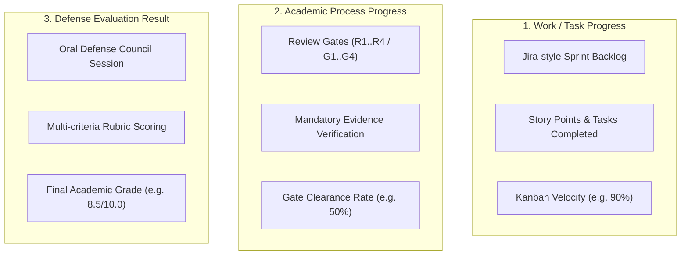

# 03 — FRONTEND INTEGRATION GAP MATRIX & API CONSUMPTION
**AI-PMS (Academic Information & Project Management System)**  
**Branch:** `feat/uiux-master-redesign`  
**Auditor:** Senior Frontend Integration Architect  

---

## 1. Three Independent Progress & Evaluation Streams

To prevent data conflation and ensure clear academic governance, the frontend strictly delineates three distinct progress streams:

- **Stream 1 (Work Progress):** Reflects operational day-to-day agile effort. Sourced from `tasks.api.ts` and `sprints.api.ts`.
- **Stream 2 (Academic Process):** Reflects legal university milestone compliance. Sourced from `review-gates-api.ts`.
- **Stream 3 (Evaluation Result):** Reflects committee appraisal. Sourced from `evaluations.api.ts`.

---

## 2. Screen-by-Screen Action & API Dependency Matrix

| Screen / Workspace | User Trigger Action | Current FE DTO / Payload | Target Backend Endpoint | Backend Dependency (`BACKEND_DEPENDENCY`) |
| :--- | :--- | :--- | :--- | :--- |
| **Student Review Timeline** `/project/review-gates` | Page Load / Gate Select | `projectId: string` (optional) | `GET /api/v1/projects/{id}/review-gates/timeline` | **NEW:** BE must supply `StudentReviewTimelineDto` with `capabilities`, `blockingReasons`, `effectivePolicyVersion`, and gate instances. |
| **Review Submission Modal** `ReviewSubmissionModal.tsx` | Submit Evidence / Revision | `SubmitRevisionRequest` `(projectId, gateCode, requirementId, artifactName, notes, expectedVersion)` | `POST /api/v1/projects/{id}/review-gates/{code}/evidence` | **NEW:** File upload handler, storage presigned URL generator, SHA-256 checksum, version incrementer. |
| **Reviewer Queue** `/review/gate-assignments` | Page Load | None (Auth Bearer Token) | `GET /api/v1/reviewers/me/gate-assignments` | **NEW:** Query returning active assignments filtered by authenticated reviewer ID with conflict isolation. |
| **Reviewer Verification** `AssignedReviewQueue.tsx` | Verify Evidence Item (Accept / Reject) | `VerifyEvidenceRequest` `(assignmentId, requirementId, decision, feedback, concurrencyToken)` | `POST /api/v1/review-gates/assignments/{id}/evidence/{reqId}/verify` | **NEW:** Updates evidence status in `dbo.GateEvidenceLedgers`; returns updated `concurrencyToken`. |
| **Reviewer Decision** `AssignedReviewQueue.tsx` | Record Gate Verdict (Passed / Revision Required) | `GateDecisionRequest` `(assignmentId, decision, notes, concurrencyToken)` | `POST /api/v1/review-gates/assignments/{id}/decision` | **NEW:** Validates mandatory evidence completeness; executes state transition; updates downstream gate eligibility. |
| **Department Gate Matrix** `/academic/review-gates` | Page Load / Filter Mode | `filterMode: 'ALL' \| 'SINGLE_MAJOR' \| 'INTERDISCIPLINARY'` | `GET /api/v1/departments/{id}/review-gates/matrix` | **NEW:** Cohort projection returning project progress rows, gate statuses, and active blocker arrays. |
| **Gate Template Builder** `ReviewGateBuilder.tsx` | Save Draft Template | `ReviewGateTemplate` `(id, code, name, mode, major, gates, concurrencyToken)` | `POST /api/v1/academic/gate-templates` (Create) `PUT /api/v1/academic/gate-templates/{id}` (Update) | **NEW:** Persistence in `dbo.ReviewGateTemplates` and `dbo.GateTemplateCriteria`. Optimistic concurrency on token. |
| **Gate Template Builder** `ReviewGateBuilder.tsx` | Publish Template | `id: string` | `POST /api/v1/academic/gate-templates/{id}/publish` | **NEW:** Validates non-empty gates; locks template structure; freezes version; advances version number. |
| **Defense Readiness** `DefenseReadinessChecker.tsx`| Page Load / Recheck | `projectId: string` | `GET /api/v1/projects/{id}/defense-readiness` | **NEW:** Aggregates gate clearance, final submission package, supervisor sign-off, and student academic standing. |
| **Interdisciplinary Panel** `InterdisciplinaryGatePanel.tsx`| Scope Decision Update | `(projectId, scope, newStatus)` | `POST /api/v1/projects/{id}/review-gates/{code}/scopes/{scope}` | **NEW:** Records discipline-specific reviewer verdict; checks if all participating scopes passed. |
| **Supervisor Follow-up** `SupervisorGateFollowupPanel.tsx`| Send Advisory Feedback | `(projectId, gateCode, feedbackText)` | `POST /api/v1/projects/{id}/review-gates/{code}/mentor-feedback` | **NEW:** Stores mentor advisory comments in `dbo.ProjectGateInstances.MentorFeedback`. |

---

## 3. Detailed Data Contract Gaps for Review Gates

The real backend DTO must supply the following 17 canonical data points to satisfy the existing frontend UI without data loss:

1. `projectId` (string / UUID)
2. `projectMode` (`SINGLE_MAJOR` | `INTERDISCIPLINARY`)
3. `academicScope` (`COMMON` | `IT` | `Marketing` | `Design`)
4. `appliedTemplateVersion` (string, e.g., `"1.0"`)
5. `gateId` & `gateCode` (e.g., `"inst-r2"`, `"R2"`)
6. `gateSequence` (integer: 1, 2, 3, 4)
7. `gateStatus` (`PLANNED` | `IN_REVIEW` | `PASSED` | `REVISION_REQUIRED` | `LOCKED`)
8. `reviewerActor` (Responsible reviewer name or role)
9. `requirements` (Array of items with `title`, `type`, `scope`, `isMandatory`)
10. `verificationStatus` (`PENDING` | `SUBMITTED` | `ACCEPTED` | `REJECTED`)
11. `missingEvidenceCount` (Number of mandatory items not yet accepted)
12. `blockingReasons` (Array of `{ code, requirementCode, message }`)
13. `capabilities` (`canSubmitPackage`, `canSubmitRevision`, `blockingReasons`)
14. `submissionAttempts` (History array of artifacts with version, timestamp, uploader)
15. `reviewDecisions` (Itemized feedback and general reviewer notes)
16. `deadline` (`windowStart`, `windowEnd`)
17. `concurrencyToken` (Opaque string / RowVersion base64)
