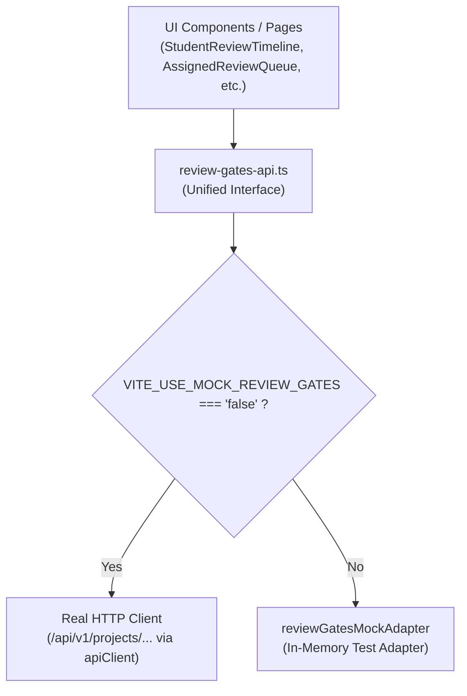

# 05 — API ADAPTER READINESS & CONTRACT MAPPING SPECIFICATION
**AI-PMS (Academic Information & Project Management System)**  
**Target File:** `src/features/review-gates/api/review-gates-api.ts`  
**Pattern:** Clean Dual-Mode Adapter with Runtime Environment Toggle  

---

## 1. Dual-Mode Architecture Overview

To ensure that developers can run automated UI tests and offline demos without requiring a live ASP.NET Core database, while also enabling instant zero-code-change cutover to production, `review-gates-api.ts` adopts a dual-mode adapter pattern.



---

## 2. Refactored Implementation (`review-gates-api.ts`)

```typescript
import { httpGet, httpPost, httpPut } from '../../../services/http/http-client'
import { reviewGatesMockAdapter } from './review-gates-mock-adapter'
import type {
  AssignedReviewItem,
  DefenseReadinessSummary,
  GateDecisionRequest,
  ProjectReviewMatrixRow,
  ReviewGateTemplate,
  StudentReviewTimelineDto,
  SubmitRevisionRequest,
  VerifyEvidenceRequest,
} from '../types/review-gates.types'

/**
 * Feature flag controlling Review Gates data source:
 * - 'true' (or unset in test): Uses in-memory reviewGatesMockAdapter.
 * - 'false': Dispatches real HTTP requests to ASP.NET Core backend.
 */
const useMock = import.meta.env.VITE_USE_MOCK_REVIEW_GATES !== 'false'

export async function getReviewGateTemplates(): Promise<ReviewGateTemplate[]> {
  if (useMock) return reviewGatesMockAdapter.getTemplates()
  return httpGet<ReviewGateTemplate[]>('/academic/gate-templates')
}

export async function getReviewGateTemplate(id: string): Promise<ReviewGateTemplate | null> {
  if (useMock) return reviewGatesMockAdapter.getTemplateById(id)
  return httpGet<ReviewGateTemplate>(`/academic/gate-templates/${id}`)
}

export async function saveReviewGateTemplate(template: ReviewGateTemplate): Promise<ReviewGateTemplate> {
  if (useMock) return reviewGatesMockAdapter.saveTemplate(template)
  if (template.id && !template.id.startsWith('tmpl-temp')) {
    return httpPut<ReviewGateTemplate>(`/academic/gate-templates/${template.id}`, template)
  }
  return httpPost<ReviewGateTemplate>('/academic/gate-templates', template)
}

export async function publishReviewGateTemplate(id: string): Promise<ReviewGateTemplate> {
  if (useMock) return reviewGatesMockAdapter.publishTemplate(id)
  return httpPost<ReviewGateTemplate>(`/academic/gate-templates/${id}/publish`, {})
}

export async function getProjectReviewMatrix(filterMode?: string): Promise<ProjectReviewMatrixRow[]> {
  if (useMock) return reviewGatesMockAdapter.getMonitoringMatrix(filterMode)
  const query = filterMode && filterMode !== 'ALL' ? `?mode=${filterMode}` : ''
  return httpGet<ProjectReviewMatrixRow[]>(`/departments/review-gates/matrix${query}`)
}

export async function updateGateDecision(
  projectId: string,
  gateCode: string,
  newStatus: 'PASSED' | 'REVISION_REQUIRED' | 'IN_REVIEW',
): Promise<ProjectReviewMatrixRow> {
  if (useMock) return reviewGatesMockAdapter.updateProjectGateDecision(projectId, gateCode, newStatus)
  return httpPost<ProjectReviewMatrixRow>(`/projects/${projectId}/review-gates/${gateCode}/decision`, { newStatus })
}

export async function updateHybridScopeDecision(
  projectId: string,
  scope: string,
  newStatus: 'PASSED' | 'REVISION_REQUIRED' | 'IN_REVIEW',
): Promise<ProjectReviewMatrixRow> {
  if (useMock) return reviewGatesMockAdapter.updateHybridScopeDecision(projectId, scope, newStatus)
  return httpPost<ProjectReviewMatrixRow>(`/projects/${projectId}/review-gates/scopes/${scope}`, { newStatus })
}

export async function getDefenseReadiness(projectId: string): Promise<DefenseReadinessSummary> {
  if (useMock) return reviewGatesMockAdapter.getDefenseReadiness(projectId)
  return httpGet<DefenseReadinessSummary>(`/projects/${projectId}/defense-readiness`)
}

export async function getStudentReviewTimeline(projectId?: string): Promise<StudentReviewTimelineDto> {
  if (useMock) return reviewGatesMockAdapter.getStudentReviewTimeline(projectId)
  const path = projectId ? `/projects/${projectId}/review-gates/timeline` : '/students/me/review-gates/timeline'
  return httpGet<StudentReviewTimelineDto>(path)
}

export async function submitRevision(
  req: SubmitRevisionRequest,
  isLeader: boolean,
): Promise<StudentReviewTimelineDto> {
  if (useMock) return reviewGatesMockAdapter.submitRevision(req, isLeader)
  return httpPost<StudentReviewTimelineDto>(`/projects/${req.projectId}/review-gates/${req.gateCode}/evidence`, req)
}

export async function getAssignedReviews(): Promise<AssignedReviewItem[]> {
  if (useMock) return reviewGatesMockAdapter.getAssignedReviews()
  return httpGet<AssignedReviewItem[]>('/reviewers/me/gate-assignments')
}

export async function verifyEvidence(req: VerifyEvidenceRequest): Promise<AssignedReviewItem> {
  if (useMock) return reviewGatesMockAdapter.verifyEvidence(req)
  return httpPost<AssignedReviewItem>(`/review-gates/assignments/${req.assignmentId}/evidence/${req.requirementId}/verify`, req)
}

export async function submitGateDecision(req: GateDecisionRequest): Promise<AssignedReviewItem> {
  if (useMock) return reviewGatesMockAdapter.submitGateDecision(req)
  return httpPost<AssignedReviewItem>(`/review-gates/assignments/${req.assignmentId}/decision`, req)
}
```

---

## 3. DTO Reconciliations & Enum Alignments

| Domain Field | Frontend Name (`review-gates.types.ts`) | Backend Name (`AIPMS.Api` / `Domain`) | Mapping Policy |
| :--- | :--- | :--- | :--- |
| **Gate Status** | `'PLANNED'`, `'IN_REVIEW'`, `'PASSED'`, `'REVISION_REQUIRED'`, `'LOCKED'` | `'LOCKED'`, `'OPEN_FOR_SUBMISSION'`, `'UNDER_REVIEW'`, `'PASSED'`, `'REVISION_REQUIRED'`, `'FAILED'`, `'OVERRIDDEN_PASSED'` | Map `UNDER_REVIEW` $\leftrightarrow$ `IN_REVIEW`. Map `OPEN_FOR_SUBMISSION` $\leftrightarrow$ `PLANNED` (when active). |
| **Evidence Status**| `'PENDING'`, `'SUBMITTED'`, `'ACCEPTED'`, `'REJECTED'` | `'SUBMITTED'`, `'VERIFIED'`, `'REJECTED'` | Map `VERIFIED` $\leftrightarrow$ `ACCEPTED`. |
| **Evidence Type** | `'DOCUMENT'`, `'EVIDENCE'`, `'DEMO'`, `'LINK'`, `'PREVIOUS_GATE'` | `'DOCUMENT_PDF'`, `'GIT_REPOSITORY'`, `'DEMO_URL'`, `'TEST_REPORT'`, `'MENTOR_SIGNOFF'` | Pass as-is; UI renders matching icons. |
| **Concurrency** | `concurrencyToken: string` | `RowVersion: byte[]` (base64 string in JSON) | Treat as opaque string on client; mirror back in mutation payloads. |

---

## 4. Error Envelope Handling

ASP.NET Core returns standard RFC-7807 `ProblemDetails` or the project's `ApiResponse<T>`:

```typescript
export interface BackendErrorResponse {
  title?: string
  status?: number
  detail?: string
  message?: string
  errorCode?: string
  errors?: Record<string, string[]> | string[]
}
```

The HTTP client interceptor parses this into standard user-facing notifications:
- Status `409`: Throws `ConcurrencyConflictException` triggering the reload prompt.
- Status `422`: Surfaces academic violation messages (e.g., missing mandatory evidence).
- Status `403`: Surfaces permission rejection (e.g., non-leader attempting formal sign-off).
