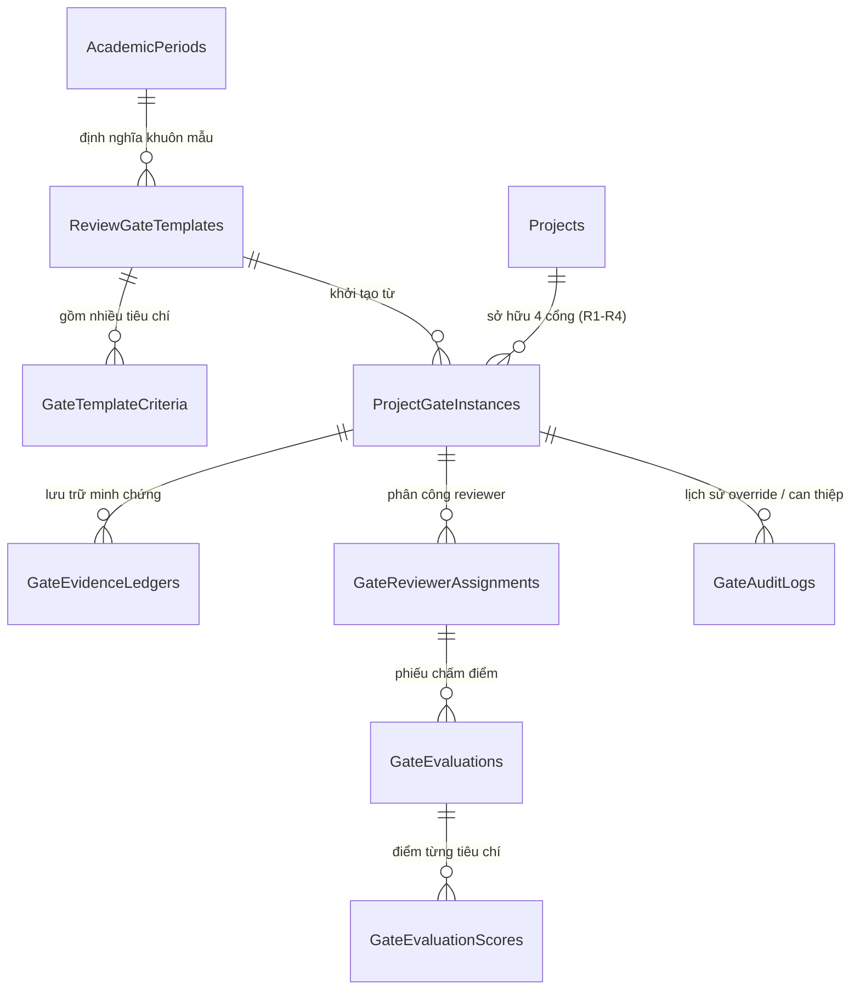
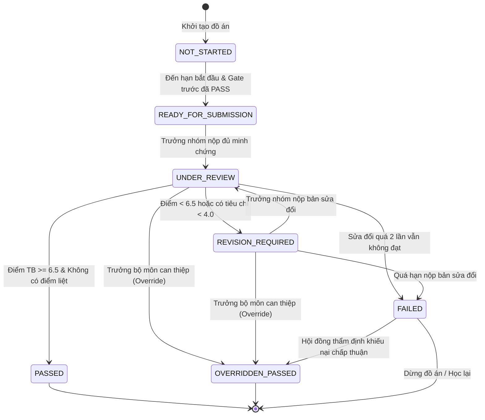

# AI-PMS — TÀI LIỆU BÀN GIAO TOÀN DIỆN KỸ THUẬT & NGHIỆP VỤ CHO BACKEND DEVELOPER
**Dự án:** Academic Information & Project Management System (AI-PMS)  
**Nhánh Frontend nguồn:** `feat/uiux-master-redesign` (Hoàn thiện 100% UI, luồng học vụ và test suite)  
**Nhánh Backend đích:** `develop`  
**Kiến trúc Backend mục tiêu:** ASP.NET Core 9 (Clean Architecture + MediatR CQRS + EF Core Database-First + SQL Server 2022)  
**Thời điểm phát hành:** Tháng 10/2026  

---

## 1. BỐI CẢNH & PHẠM VI TÍCH HỢP

### 1.1. Hiện trạng hệ thống (As-Is State)
- **80% nghiệp vụ đã có API thật trên nhánh `develop`:** Authentication (JWT), Đăng ký & Thẩm định đề tài (Proposals), Quản lý Công việc & Sprint (Tasks/Sprints), Mốc đồ án (Milestones), Phòng họp trực tuyến WebRTC (LiveKit Meetings), Nộp sản phẩm & Báo cáo (Deliverables), Chấm điểm hội đồng bảo vệ (Evaluations/Rubrics), Khiếu nại điểm (Appeals), Thông báo đẩy (Notifications).
- **20% khoảng trống cốt lõi cần Backend triển khai (The Missing Gap - P0):** Toàn bộ phân hệ **Review Gates (Các đợt thẩm định tiến độ học thuật R1 – R4)** và **Department Gate Matrix (Bảng ma trận quản lý tiến độ của Bộ môn)**.
- **Cơ chế hoạt động của Frontend:** FE đã dựng hoàn chỉnh 100% giao diện, logic học thuật, validation, và đang chạy qua Mock Adapter (`reviewGatesMockAdapter.ts`). FE đã tích hợp sẵn công tắc chuyển đổi: **Chỉ cần đặt `VITE_USE_MOCK_REVIEW_GATES=false` trong `.env` là tự động trỏ thẳng vào các API thật của Backend**.

### 1.2. Các tính năng FE mới hoàn thiện cần BE lưu ý
1. **Bảng Kanban kéo thả (Task Board):** Người dùng có thể kéo thả thẻ task giữa các cột `TODO`, `IN_PROGRESS`, `BLOCKED`, `IN_REVIEW`, `DONE`. FE gọi API `PUT /api/v1/tasks/{id}/status` với payload `{ status: string }`.
2. **Nộp minh chứng Review Gates (Hỗ trợ File thật & Link ngoài):** Modal nộp tài liệu hỗ trợ tải tệp (PDF, DOCX, ZIP tối đa 25MB) và link ngoài (Git PR, Google Drive). BE cần chuẩn bị endpoint nhận multipart file upload và lưu trữ an toàn.
3. **Chat Realtime & SignalR Hub:** Giao diện bong bóng nổi và khung chat thu gọn, nhận diện trạng thái kết nối realtime qua Hub `/hubs/chat` và unread notification badge qua `/hubs/notifications`.

---

## 2. KIẾN TRÚC CƠ SỞ DỮ LIỆU & SCRIPT MIGRATION (PR1)

BE cần triển khai Migration script **`V061__create_review_gates_schema.sql`** (đặt trong thư mục `db/changes/` của repo BE) để tạo 8 bảng phục vụ Review Gates và 1 bảng phục vụ đồ án liên ngành.



### 2.1. Danh mục 9 bảng dữ liệu mới

| Tên bảng | Mục đích nghiệp vụ | Khóa chính & Khóa ngoại cốt lõi | Lưu ý kỹ thuật |
| :--- | :--- | :--- | :--- |
| **`dbo.ReviewGateTemplates`** | Khuôn mẫu cấu hình các cổng R1–R4 theo từng học kỳ/ngành | PK: `Id` (GUID)<br>FK: `AcademicPeriodId`, `MajorId` | `UNIQUE(AcademicPeriodId, MajorId, GateSequence)` |
| **`dbo.GateTemplateCriteria`** | Tiêu chí chấm điểm thành phần và trọng số của từng cổng | PK: `Id` (GUID)<br>FK: `GateTemplateId` | `CHECK(WeightPercentage > 0)`<br>Tổng trọng số = 100% |
| **`dbo.ProjectGateInstances`** | Thực thể cổng cụ thể gắn với từng đồ án sinh viên | PK: `Id` (GUID)<br>FK: `ProjectId`, `GateTemplateId` | Cột `RowVersion ROWVERSION` để chống xung đột ghi đồng thời |
| **`dbo.GateEvidenceLedgers`** | Sổ cái lưu vết tài liệu minh chứng, link Git PR, file nộp | PK: `Id` (GUID)<br>FK: `GateInstanceId`, `UploadedBy` | Không bao giờ xóa cứng (Soft-delete hoặc audit trail) |
| **`dbo.GateReviewerAssignments`** | Phân công Giảng viên phản biện độc lập cho từng cổng | PK: `Id` (GUID)<br>FK: `GateInstanceId`, `ReviewerId` | `UNIQUE(GateInstanceId, ReviewerId)` |
| **`dbo.GateEvaluations`** | Phiếu đánh giá của từng reviewer (Draft hoặc Final) | PK: `Id` (GUID)<br>FK: `AssignmentId` | `IsDraft BIT`, `CalculatedScore DECIMAL(4,2)` |
| **`dbo.GateEvaluationScores`** | Điểm số và nhận xét chi tiết cho từng tiêu chí | PK: `Id` (GUID)<br>FK: `EvaluationId`, `CriteriaId` | `CHECK(Score >= 0.0 AND Score <= 10.0)` |
| **`dbo.GateAuditLogs`** | Nhật ký kiểm toán bắt buộc khi Trưởng bộ môn can thiệp (Override) | PK: `Id` (GUID)<br>FK: `GateInstanceId`, `ActorId` | Lưu trạng thái cũ, trạng thái mới, lý do tối thiểu 50 ký tự |
| **`dbo.ProjectAffiliatedDepartments`** | Bảng liên kết phục vụ đồ án đa ngành / đồng hướng dẫn | PK: `Id` (GUID)<br>FK: `ProjectId`, `DepartmentId` | Cho phép nhiều bộ môn cùng giám sát đồ án liên ngành |

> [!IMPORTANT]
> **Quy tắc toàn vẹn:** Tất cả các Foreign Key phải dùng `ON DELETE NO ACTION` để triệt tiêu lỗi multiple cascade path trong SQL Server. Thuộc tính `RowVersion` phải được cấu hình `.IsRowVersion()` trong Fluent API EF Core để hỗ trợ Optimistic Concurrency Control.

---

## 3. ĐẶC TẢ HỢP ĐỒNG API CHI TIẾT (API CONTRACT & DTOS)

Tất cả các API tuân thủ chuẩn RESTful, tiền tố `/api/v1`, định dạng JSON camelCase, phản hồi kèm `TraceId` và bọc trong cấu trúc chuẩn:
```json
{
  "success": true,
  "data": { ... },
  "message": "Thông báo nếu có",
  "errors": []
}
```

### Nhóm 1: Dành cho Sinh viên — Quản lý Tiến trình Cổng & Nộp Minh chứng
**Controller:** `src/AIPMS.Api/Controllers/ProjectReviewGatesController.cs`

#### 1. Lấy tổng quan các đợt thẩm định & KPI đồ án
- **Endpoint:** `GET /api/v1/projects/{projectId}/review-gates`
- **Quyền truy cập:** Sinh viên trong nhóm, GVHD, Reviewer được phân công, Cán bộ bộ môn.
- **Phản hồi (HTTP 200):**
```json
{
  "projectId": "guid-project-id",
  "projectCode": "PROJ-2026-SE01",
  "projectTitle": "Campus Support & Food Delivery Platform",
  "kpis": {
    "clearanceRatePercentage": 50.0,
    "currentEvidenceScore": 8.5,
    "blockingIssuesCount": 1,
    "nextUpcomingDeadlineUtc": "2026-11-15T17:00:00Z"
  },
  "gates": [
    {
      "gateInstanceId": "guid-gate-1",
      "gateSequence": 1,
      "gateName": "R1 - SRS & Architecture Verification",
      "status": "PASSED",
      "isMandatory": true,
      "deadlineUtc": "2026-10-10T17:00:00Z",
      "finalScore": 8.5,
      "evidenceCount": 3,
      "isLocked": false,
      "lockReason": null
    },
    {
      "gateInstanceId": "guid-gate-2",
      "gateSequence": 2,
      "gateName": "R2 - Working Prototype & Midterm Review",
      "status": "REVISION_REQUIRED",
      "isMandatory": true,
      "deadlineUtc": "2026-11-15T17:00:00Z",
      "finalScore": 5.0,
      "evidenceCount": 2,
      "isLocked": false,
      "lockReason": null
    }
  ]
}
```

#### 2. Nộp tài liệu minh chứng (Evidence Ledger)
- **Endpoint:** `POST /api/v1/projects/{projectId}/review-gates/{gateId}/evidence`
- **Quyền:** Chỉ **Trưởng nhóm (Student Leader)**.
- **Request (Multipart/Form-Data hoặc JSON):**
```json
{
  "evidenceType": "FILE_UPLOAD", // hoặc "GIT_PR", "CLOUD_STORAGE_URL"
  "title": "Software Architecture Document v2.0",
  "description": "Đã chỉnh sửa theo nhận xét của Reviewer ở đợt R1",
  "externalUrl": "https://github.com/my-org/my-project/pull/42",
  "fileStorageKey": "artifacts/2026/proj-50/sdd-v2.pdf",
  "fileSizeBytes": 4520100,
  "contentType": "application/pdf"
}
```
- **Phản hồi (HTTP 201 Created):** Trả về đối tượng `EvidenceLedgerItemDto`.

#### 3. Chốt nộp đợt review (Lock & Submit for Review)
- **Endpoint:** `POST /api/v1/projects/{projectId}/review-gates/{gateId}/submit-for-review`
- **Quyền:** Chỉ **Trưởng nhóm (Student Leader)**.
- **Validation BE:** Kiểm tra tất cả minh chứng bắt buộc đã nộp; trạng thái cổng hiện tại phải là `READY_FOR_SUBMISSION` hoặc `REVISION_REQUIRED`.
- **Hành vi BE:** Chuyển trạng thái cổng sang `UNDER_REVIEW`, khóa không cho sửa đổi minh chứng, bắn SignalR thông báo cho các Reviewer được phân công.

---

### Nhóm 2: Dành cho Giảng viên Phản biện Độc lập (Reviewer)
**Controller:** `src/AIPMS.Api/Controllers/ReviewerGateEvaluationsController.cs`

#### 4. Lấy danh sách đồ án được phân công chấm cổng
- **Endpoint:** `GET /api/v1/review-gates/my-assigned-reviews`
- **Quyền:** Giảng viên (`Lecturer`).
- **Phản hồi (HTTP 200):** Danh sách các đồ án đang ở trạng thái `UNDER_REVIEW` mà giảng viên được phân công.

#### 5. Chấm điểm tiêu chí & Nhận xét cổng
- **Endpoint:** `POST /api/v1/review-gates/{gateId}/evaluations`
- **Quyền:** Giảng viên phản biện được phân công chấm cổng này.
- **Quy tắc bắt buộc (`BR-GATE-028`):** Từ chối ngay nếu Reviewer là GVHD chính hoặc đồng hướng dẫn của đồ án.
- **Request Body:**
```json
{
  "concurrencyToken": "AAAAAAAAB9M=", // RowVersion string
  "isDraft": false, // true = lưu nháp, false = chốt kết quả chính thức
  "generalFeedback": "Tài liệu thiết kế chi tiết tốt. Prototype đáp ứng 80% tính năng lõi.",
  "scores": [
    {
      "criteriaId": "guid-criteria-1",
      "score": 8.0,
      "feedback": "Phân tích kiến trúc rõ ràng"
    },
    {
      "criteriaId": "guid-criteria-2",
      "score": 7.5,
      "feedback": "Cần hoàn thiện thêm luồng thanh toán"
    }
  ]
}
```
- **Xử lý Consensus Engine tự động trên BE:**
  - Nếu `isDraft == false`: Lưu kết quả đánh giá của reviewer.
  - Kiểm tra xem tất cả các reviewer được phân công đã nộp bản chính thức chưa.
  - Nếu đủ: Tính điểm trung bình có trọng số.
    - Điểm $\ge 6.5$ (hoặc ngưỡng quy định) và không có tiêu chí nào dưới 4.0: Chuyển cổng sang `PASSED`, mở khóa cổng tiếp theo, bắn sự kiện `GatePassedDomainEvent`.
    - Điểm $< 6.5$ hoặc có tiêu chí $< 4.0$: Chuyển cổng sang `REVISION_REQUIRED`, mở lại quyền nộp cho sinh viên, bắn `GateRevisionRequiredDomainEvent`.

---

### Nhóm 3: Dành cho Bộ môn (Department Head)
**Controller:** `src/AIPMS.Api/Controllers/DepartmentReviewGatesController.cs`

#### 6. Bảng ma trận theo dõi tiến độ toàn khóa (Department Gate Matrix)
- **Endpoint:** `GET /api/v1/departments/{deptId}/review-gates/matrix`
- **Query Params:** `academicPeriodId`, `majorId`, `search`, `statusFilter`, `page`, `pageSize`.
- **Yêu cầu hiệu năng:** Viết raw query hoặc compiled query EF Core tối ưu, query dưới 150ms cho 100+ đồ án.
- **Phản hồi (HTTP 200):**
```json
{
  "departmentId": "guid-dept-id",
  "academicPeriodName": "Học kỳ 1 - 2026-2027",
  "summary": {
    "totalProjects": 45,
    "clearedAllGatesCount": 18,
    "atRiskProjectsCount": 5,
    "blockedCount": 2
  },
  "rows": [
    {
      "projectId": "guid-proj-1",
      "projectCode": "SE-01",
      "projectTitle": "Hệ thống AI Chatbot",
      "primarySupervisor": "TS. Nguyễn Văn A",
      "gate1Status": "PASSED",
      "gate2Status": "PASSED",
      "gate3Status": "UNDER_REVIEW",
      "gate4Status": "NOT_STARTED",
      "overallRiskLevel": "LOW"
    }
  ],
  "page": 1,
  "pageSize": 20,
  "totalCount": 45
}
```

#### 7. Quyền can thiệp khẩn cấp của Trưởng bộ môn (Emergency Override)
- **Endpoint:** `POST /api/v1/review-gates/{gateId}/override`
- **Quyền:** Chỉ **Trưởng bộ môn (Department Head)**.
- **Validation:** Bắt buộc có lý do giải trình (`justificationReason`) tối thiểu 50 ký tự.
- **Hành vi BE:** Cập nhật trạng thái cổng thành `OVERRIDDEN_PASSED`, chèn bản ghi bất biến vào `dbo.GateAuditLogs`, gửi thông báo đến sinh viên, GVHD và các reviewer.

---

## 4. DANH MỤC QUY CHẾ HỌC THUẬT BẮT BUỘC (BUSINESS RULES)

Backend Developer bắt buộc phải cài đặt các Rule sau thành FluentValidation và Domain Guard Clauses:

1. **`BR-GATE-002` (Hard Gate Invariant):** Cổng $N$ chỉ được phép mở nộp bài khi Cổng $N-1$ đã đạt trạng thái `PASSED` hoặc `OVERRIDDEN_PASSED`. Nếu Cổng $N-1$ chưa xong, API phải chặn nộp bài và trả về HTTP `422 Unprocessable Entity` (`ERR_PREVIOUS_GATE_NOT_CLEARED`).
2. **`BR-GATE-015` (Leader Privilege):** Chỉ người dùng mang cờ `IsLeader = true` trong nhóm mới được quyền bấm "Nộp tài liệu", "Xóa tài liệu" và "Chốt nộp đợt review". Thành viên khác thao tác sẽ bị chặn với HTTP `403 Forbidden` (`ERR_STUDENT_MEMBER_SUBMISSION_DENIED`).
3. **`BR-GATE-028` (Reviewer Conflict of Interest Isolation):** Một giảng viên **tuyệt đối không được phép** phân công làm Reviewer chấm cổng cho đồ án mà mình là GVHD chính (`PRIMARY_SUPERVISOR`) hoặc đồng hướng dẫn (`CO_SUPERVISOR`). Vi phạm phải bị từ chối với mã lỗi `ERR_REVIEWER_CONFLICT_OF_INTEREST`.
4. **`BR-GATE-030` (Consensus Threshold):** Cổng chỉ được coi là đạt (`PASSED`) khi điểm trung bình có trọng số $\ge 6.5$ và không có tiêu chí nào dưới $4.0$. Nếu đồ án bị sửa đổi quá 2 lần mà vẫn không đạt thì chuyển trạng thái `FAILED`.
5. **`BR-GATE-032` (Override Accountability):** Trưởng bộ môn can thiệp phải có giải trình tối thiểu 50 ký tự. Hệ thống tự động ghi nhật ký kiểm toán không thể xóa (`GateAuditLogs`).
6. **`BR-GATE-035` (Concurrency Safeguard):** Khi chấm điểm hoặc duyệt cổng, phải kiểm tra `RowVersion`. Nếu phát hiện phiên bản đã thay đổi thì từ chối với HTTP `409 Conflict` (`ERR_CONCURRENCY_VIOLATION`).

---

## 5. MÁY TRẠNG THÁI CỔNG THẨM ĐỊNH (STATE MACHINE)



---

## 6. LỘ TRÌNH TRIỂN KHAI 6 PULL REQUESTS CHO BE DEV

Backend Developer triển khai tuần tự theo 6 PR sau để đảm bảo kiểm thử liên tục:

- **PR1 — Database Schema & EF Core Configurations (P0):**
  - Chạy script `V061__create_review_gates_schema.sql`.
  - Tạo các Entity C# trong `src/AIPMS.Domain/Entities/ReviewGates/`.
  - Cấu hình EF Core DbContext, Map Index và RowVersion.
  - *DoD:* Database build thành công, DbContext test in-memory pass 100%.

- **PR2 — Student Gate Timeline & Evidence Ledger API (P0):**
  - Viết `GetProjectReviewGatesQuery` và `SubmitGateEvidenceCommand`.
  - Tạo `ProjectReviewGatesController.cs`.
  - *DoD:* Postman có thể gọi xem timeline đồ án và upload file minh chứng.

- **PR3 — Reviewer Assignment, Conflict Check & Scoring Engine (P0):**
  - Cài đặt rule `BR-GATE-028` chặn GVHD chấm đồ án của mình.
  - Viết `SubmitGateEvaluationCommand` và bộ tính điểm Consensus.
  - Tạo `ReviewerGateEvaluationsController.cs`.
  - *DoD:* Chấm điểm lưu được draft và tính điểm tự động chuyển trạng thái cổng.

- **PR4 — Department Gate Matrix & Override Mechanics (P0):**
  - Viết Query ma trận tối ưu cho toàn bộ môn.
  - Cài đặt `OverrideGateDecisionCommand` ghi log `GateAuditLogs`.
  - Tạo `DepartmentReviewGatesController.cs`.
  - *DoD:* Trưởng bộ môn xem được danh sách toàn khóa và can thiệp thành công.

- **PR5 — Composite Aggregators & SignalR Realtime Push (P1):**
  - Tạo các endpoint tổng hợp `/students/me/next-actions`, `/supervisors/me/triage-queue`.
  - Bắn event SignalR qua `NotificationHub` khi cổng đổi trạng thái.
  - *DoD:* FE load widget trang chủ bằng 1 request duy nhất; chuông thông báo nhảy realtime.

- **PR6 — Acceptance Tests & Production Hardening (P2):**
  - Viết bộ test xUnit kịch bản đơn ngành và liên ngành.
  - Chạy stress test 5 requests chấm điểm đồng thời kiểm tra `RowVersion`.
  - *DoD:* CI/CD pass 100%, Swagger đầy đủ mô tả XML comments và status codes.

---

## 7. CƠ CHẾ NỐI VÀ KIỂM THỬ GIỮA FRONTEND VÀ BACKEND

Khi BE hoàn thành PR2 (hoặc môi trường Dev BE đã sẵn sàng):
1. **Phía FE:** Mở file `.env` và chuyển cờ:
   ```bash
   VITE_USE_MOCK_REVIEW_GATES=false
   VITE_API_BASE_URL=http://localhost:5000/api/v1
   ```
2. **Kịch bản kiểm thử tích hợp đầu tiên:**
   - Đăng nhập tài khoản Trưởng nhóm (`Student Leader`).
   - Mở trang Timeline Review Gate (`/workspace/student/review-gates`).
   - Kéo thả file PDF vào Cổng R2 và nhấn "Xác nhận nộp bản sửa".
   - Kiểm tra Database BE xem bảng `GateEvidenceLedgers` và `ProjectGateInstances` có nhận đúng dữ liệu và chuyển trạng thái sang `UNDER_REVIEW` không.
