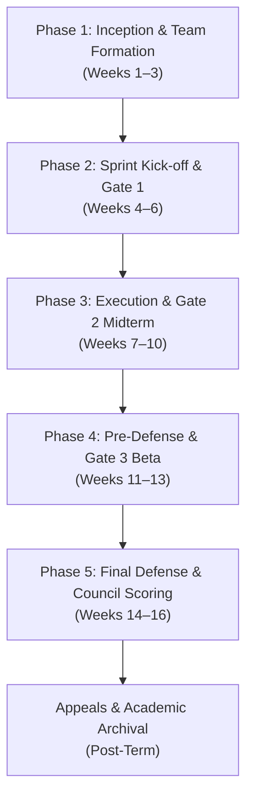
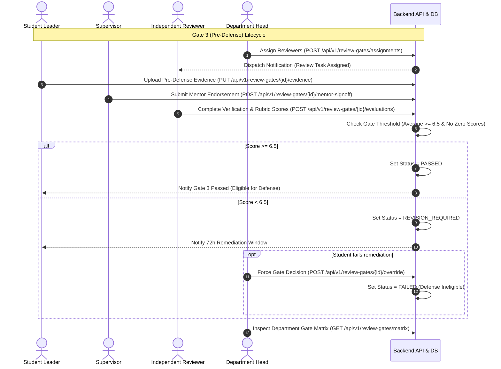

# 02 — END-TO-END BUSINESS WORKFLOW SPECIFICATION
**AI-PMS (Academic Information & Project Management System)**  
**Branch:** `feat/uiux-master-redesign`  
**Domain:** Higher Education Capstone & Final Year Project Governance  

---

## 1. Academic Project Lifecycle Overview

The AI-PMS system governs a strict 15-to-18 week university capstone semester. The lifecycle is partitioned into five distinct, sequential phases with rigid academic gating rules.

---

## 2. Phase-by-Phase Detailed Workflow & Role Interactions

### Phase 1: Inception, Team Formation & Topic Proposal (Weeks 1–3)
1. **Team Formation:**
   - **Student (Team Leader):** Creates a capstone team, selects major/specialization (e.g., Software Engineering, AI, Information Systems, or Interdisciplinary).
   - **Student (Members):** Receives invitation email/notification; accepts or rejects invitation via `StudentTeamPage.tsx`. Team size must adhere to policy (minimum 3, maximum 5 students).
2. **Topic Selection & Proposal Registration:**
   - Team leader submits Topic Proposal (`StudentProposalPage.tsx`): Topic title in Vietnamese & English, problem statement, target objectives, technology stack, expected deliverables, proposed supervisor/mentor.
   - **Supervisor Review:** Supervisor inspects submitted proposals in `SupervisorProposalReviewPage.tsx`. Can:
     - *Request Revision* (returns proposal to student with line-item comments).
     - *Reject* (terminates proposal; team must re-submit).
     - *Approve & Endorse* (forwards to Department Head).
3. **Department Head Endorsement & Quota Enforcement:**
   - Department Head opens `DepartmentWorkspacePage.tsx` -> Action Queue.
   - Verifies supervisor quota (max 5 active projects per supervisor).
   - Verifies interdisciplinary feasibility if multi-major.
   - Approves topic: System initializes `Project` record with status `APPROVED_ACTIVE`, seeds default `Milestones` and instantiates the `ReviewGate` schedule.

---

### Phase 2: Sprint Kick-off & Gate 1 (Proposal & Architecture Verification) (Weeks 4–6)
1. **Project Workspace Activation:**
   - Students gain access to `StudentMilestonesPage.tsx`, `TaskBoardPage.tsx`, and `SprintManagementPage.tsx`.
   - Team sets up repository linkage (GitHub/GitLab webhook or repository URL), breaks project into 2-week agile sprints.
2. **Gate 1 Submission (Proposal & Architecture Sign-Off):**
   - **Student:** Uploads Software Architecture Document (SAD), User Requirements Specification (SRS), and initial Gantt timeline to `StudentGateDetailPage.tsx`.
   - **Supervisor:** Reviews artifacts, runs plagiarism/AI similarity check via `src/features/ai/`, provides weekly review feedback.
   - **Reviewer / Gate Inspector:** Conducts Gate 1 evaluation in `ReviewerGateVerificationPage.tsx`. Verifies that requirements meet ABET/academic accreditation criteria.
   - **Outcome:** Gate 1 status transitions to `PASSED` -> Unlocks Phase 3 milestones. If `REVISION_REQUIRED`, students have 5 business days to patch documents before a hard penalty.

---

### Phase 3: Project Execution, Weekly Mentorship & Gate 2 (Midterm / Alpha Gate) (Weeks 7–10)
1. **Agile Execution & Task Tracking:**
   - Students create and update tasks (`TODO`, `IN_PROGRESS`, `CODE_REVIEW`, `DONE`) with assigned story points and assignees.
   - Supervisors view velocity and burndown charts in `SupervisorDashboardPage.tsx`.
2. **Weekly Mentorship & Meeting Logs:**
   - Supervisor schedules mandatory weekly sync in `SupervisorMeetingsPage.tsx`.
   - Both parties join LiveKit WebRTC room (`VideoRoomPage.tsx`).
   - Platform automatically records meeting duration, attendance log, and meeting minutes. Meeting completion is a prerequisite for Gate clearance.
3. **Gate 2: Midterm / Alpha Prototype Clearance:**
   - **Prerequisites:** Minimum 4 recorded supervisor meetings + at least 40% backlog tasks marked `DONE`.
   - **Evidence Required:** Deployed Alpha demo URL, source code commit tag, API documentation, Midterm Progress Report.
   - **Evaluation:** Evaluated by Supervisor + Independent Reviewer.
   - **Gate Outcome:**
     - `PASSED`: Project remains on normal defense track.
     - `AT_RISK`: Yellow warning flag displayed on Department Matrix.
     - `FAILED`: Project terminated or postponed to next semester.

---

### Phase 4: Pre-Defense, Deliverables Ledger & Gate 3 (Beta Gate) (Weeks 11–13)
1. **Beta Release Verification:**
   - Gate 3 serves as the "Pre-Defense Filter" (Eligibility gate for final defense).
   - Requires completed functional testing, security scan results, and draft Final Thesis Report.
2. **Department Reviewer Assignment:**
   - Department Head uses `DepartmentReviewerAssignmentPage.tsx` to assign 2 independent reviewers per project.
   - System enforces conflict-of-interest check: Supervisor cannot be assigned as reviewer for their own team.
3. **Gate 3 Verification & Committee Triage:**
   - Reviewers independently score the project against standardized rubrics.
   - Department Head reviews cohort clearance on `DepartmentGateMatrixPage.tsx`. Only projects with Gate 3 `PASSED` status are scheduled into Defense Councils.

---

### Phase 5: Final Defense, Council Scoring, Appeals & Grading (Weeks 14–16)
1. **Final Thesis & Code Submission:**
   - Team uploads final thesis PDF, source code bundle (.zip or immutable git release tag), and presentation slides via `FinalSubmissionPage.tsx`.
2. **Defense Council Session:**
   - Council consists of: 1 Council Chair, 1 Secretary, 1 Reviewer, and optional Invited Members.
   - During oral defense, council members open `ReviewerCouncilScoringPage.tsx` on tablets/laptops.
   - Real-time rubric evaluation: Individual scores across Presentation, Technical Rigor, Innovation, and Q&A.
   - System calculates weighted aggregate score.
3. **Appeals & Final Grade Locking:**
   - Students view consolidated score breakdown in `StudentEvaluationResultsPage.tsx`.
   - If a student disputes a score or procedural irregularity, they file an appeal via `StudentAppealsPage.tsx` within 72 hours of publication.
   - Department Head convenes Academic Committee in `DepartmentAppealsResolutionPage.tsx` to review evidence, interview council members, and issue final binding decision.
   - Grades are locked and exported to University Registrar.

---

## 3. High-Priority Multi-Role Interaction Sequence

