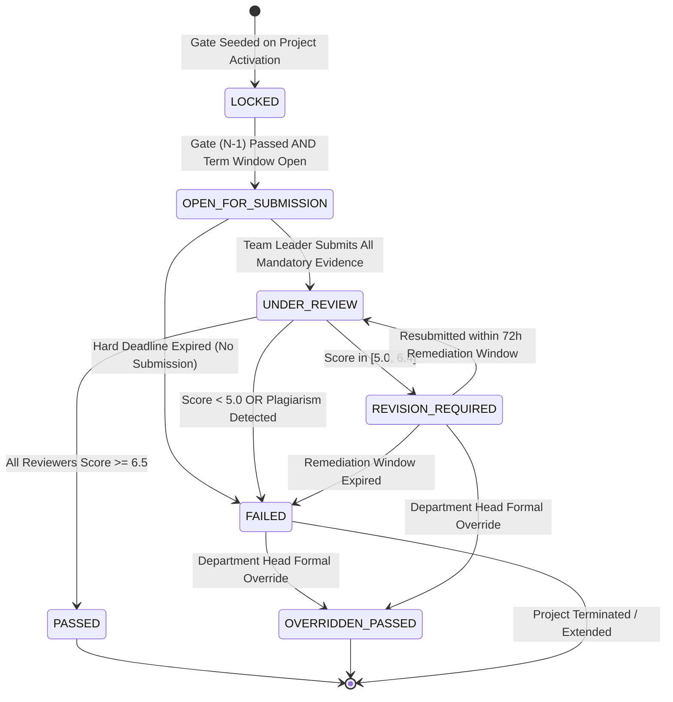
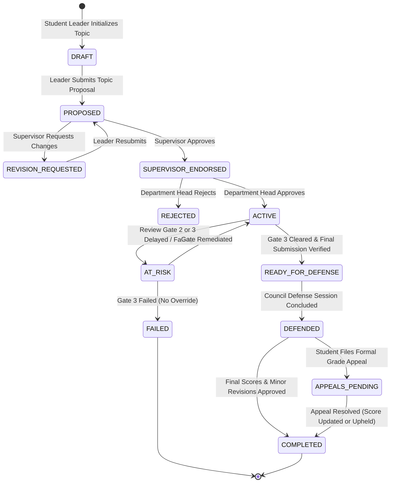
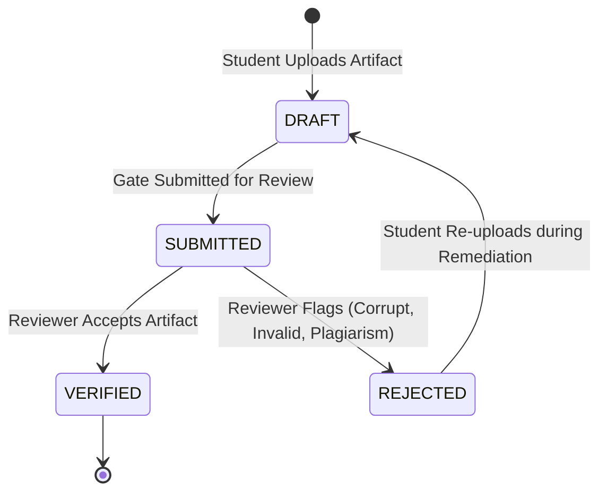
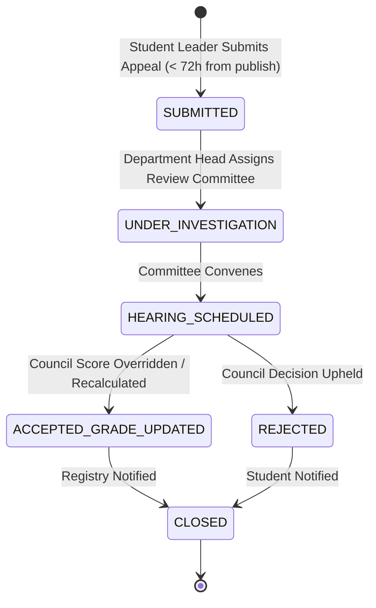

# 07 — DOMAIN STATE TRANSITIONS & FINITE STATE MACHINES
**AI-PMS (Academic Information & Project Management System)**  
**Pattern:** Strict Domain State Machine with Invariant Enforcement  

---

## 1. Review Gate Instance State Machine (`ProjectGateInstance`)

The Review Gate state machine is the core mechanism controlling student progression. Illegal state transitions are rejected with HTTP 409 Conflict.

### Transition Rule Matrix

| From State | To State | Trigger / Event | Authorized Role | Validation Invariant |
| :--- | :--- | :--- | :--- | :--- |
| `LOCKED` | `OPEN_FOR_SUBMISSION`| `GateWindowOpenedEvent` or Gate $N-1$ marked `PASSED` | System / Admin | Gate $N-1$ must be `PASSED` or `OVERRIDDEN_PASSED`. |
| `OPEN_FOR_SUBMISSION` | `UNDER_REVIEW` | `SubmitGateForReviewCommand` | `STUDENT_LEADER` | All mandatory evidence ledger items uploaded; `UtcNow <= DeadlineUtc`. |
| `OPEN_FOR_SUBMISSION` | `FAILED` | `GateDeadlineExpiredCronJob` | System | Deadline passed without submission; no active extension. |
| `UNDER_REVIEW` | `PASSED` | `GateEvaluationCompletedEvent` | System (auto-evaluated) | $\text{Avg} \ge 6.5$ AND $\min(\text{score}) \ge 4.0$. |
| `UNDER_REVIEW` | `REVISION_REQUIRED` | `GateEvaluationCompletedEvent` | System (auto-evaluated) | $\text{Avg} \in [5.0, 6.4]$; triggers 72h remediation timer. |
| `UNDER_REVIEW` | `FAILED` | `GateEvaluationCompletedEvent` | System (auto-evaluated) | $\text{Avg} < 5.0$ or reviewer marks critical failure. |
| `REVISION_REQUIRED` | `UNDER_REVIEW` | `ResubmitGateEvidenceCommand` | `STUDENT_LEADER` | Within 72h window; new revisions provided. |
| `REVISION_REQUIRED` | `FAILED` | `RemediationTimeoutCronJob` | System | 72 hours passed without resubmission. |
| `FAILED` | `OVERRIDDEN_PASSED` | `OverrideGateDecisionCommand` | `DEPARTMENT_HEAD` | Formal justification text provided ($\ge 50$ chars). |
| `REVISION_REQUIRED` | `OVERRIDDEN_PASSED` | `OverrideGateDecisionCommand` | `DEPARTMENT_HEAD` | Formal justification text provided ($\ge 50$ chars). |

---

## 2. Project Lifecycle State Machine (`Project`)

---

## 3. Evidence Ledger Item State Machine (`GateEvidenceLedger`)

---

## 4. Student Grade & Gate Appeal State Machine (`Appeals`)

---

## 5. Concurrency & State Rollback Semantics
1. **Optimistic Concurrency Control:** Every state transition checks `RowVersion` concurrency tokens. If a reviewer submits an evaluation while another reviewer or the department head updates the gate, SQL Server throws `DbUpdateConcurrencyException`. The API responds with HTTP 409 Conflict, requiring the client to refresh.
2. **Transaction Boundaries:** State transitions (e.g., updating `ProjectGateInstance.Status = PASSED`, unlocking `Gate N+1`, and recording `AuditLog`) MUST execute in an atomic database transaction. If any downstream event dispatcher fails, the database transaction rolls back completely.
