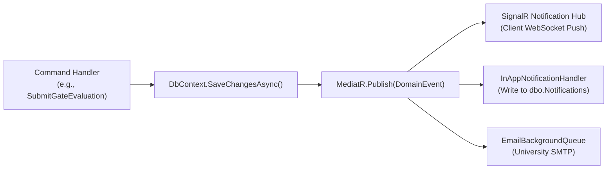

# 10 — NOTIFICATION & DOMAIN EVENTS ARCHITECTURE
**AI-PMS (Academic Information & Project Management System)**  
**Pattern:** MediatR `INotification` Domain Events -> Background Handlers -> SignalR Realtime Hub + SMTP Email  

---

## 1. Domain Event Architecture Overview

Every state transition or significant academic milestone publishes a MediatR Domain Event. This decouples core business logic from communication channels (SignalR push, in-app notification records, and university SMTP alerts).



---

## 2. Catalog of Critical Review Gate Domain Events

| Domain Event Name | Trigger Condition | Target Recipients | Delivery Channels | Urgent Level |
| :--- | :--- | :--- | :--- | :--- |
| `GateWindowOpenedDomainEvent` | Gate $N-1$ passed & semester date reached | Student Team Members | In-App, SignalR | Normal |
| `GateEvidenceSubmittedDomainEvent` | Student uploads artifact to ledger | Supervisor | In-App | Low |
| `GateSubmittedForReviewDomainEvent` | Leader locks and submits evidence | Assigned Reviewers, Supervisor | In-App, SignalR, Email | High |
| `GateReviewerAssignedDomainEvent` | Dept Head assigns reviewer to gate | Independent Reviewer | In-App, Email | High |
| `GateEvaluationSubmittedDomainEvent` | Reviewer completes scoring | System (Aggregator), Dept Head | In-App, SignalR | Normal |
| `GatePassedDomainEvent` | Average score $\ge 6.5$, criteria met | Student Team, Supervisor | In-App, SignalR, Email | High |
| `GateRevisionRequiredDomainEvent` | Average score in $[5.0, 6.4]$ | Student Team, Supervisor | In-App, SignalR, Email | **Critical (72h)** |
| `GateFailedDomainEvent` | Score $< 5.0$ or timeout | Student Team, Supervisor, Dept Head| In-App, SignalR, Email | **Critical** |
| `GateDecisionOverriddenDomainEvent`| Dept Head forces gate status | Student Team, Supervisor, Reviewer| In-App, SignalR, Email | High |
| `StudentAppealFiledDomainEvent` | Student leader disputes score | Dept Head, Committee Members | In-App, SignalR, Email | High |

---

## 3. Concrete MediatR Event Definitions (C# Contracts)

```csharp
namespace AIPMS.Domain.Events;

public sealed record GateSubmittedForReviewDomainEvent(
    Guid ProjectId,
    Guid GateInstanceId,
    int GateSequence,
    string ProjectCode,
    string ProjectTitle,
    Guid SubmittedByUserId,
    DateTime SubmittedAtUtc
) : INotification;

public sealed record GateRevisionRequiredDomainEvent(
    Guid ProjectId,
    Guid GateInstanceId,
    int GateSequence,
    string ProjectTitle,
    decimal AverageScore,
    DateTime RemediationDeadlineUtc,
    List<string> ActionableFeedbackItems
) : INotification;

public sealed record GateDecisionOverriddenDomainEvent(
    Guid ProjectId,
    Guid GateInstanceId,
    string GateName,
    string OldStatus,
    string NewStatus,
    Guid OverriddenByUserId,
    string Justification,
    DateTime OverriddenAtUtc
) : INotification;
```

---

## 4. SignalR Hub Payload Specifications (`/hubs/notifications`)

When pushed over SignalR, the frontend client intercepts messages in `useNotificationHub.ts` and updates the React state immediately without a page reload.

### Payload Schema: `ReceiveReviewGateUpdate`
```json
{
  "eventId": "e9a85f64-5717-4562-b3fc-2c963f66afa3",
  "eventType": "GATE_STATUS_CHANGED",
  "projectId": "3fa85f64-5717-4562-b3fc-2c963f66afa6",
  "gateId": "7cb85f64-5717-4562-b3fc-2c963f66afa1",
  "gateSequence": 2,
  "newStatus": "REVISION_REQUIRED",
  "title": "Gate 2 Yêu Cầu Chỉnh Sửa",
  "message": "Đề tài PRJ-2026-SEP-042 cần cập nhật minh chứng kiểm thử trong vòng 72 giờ.",
  "actionUrl": "/workspace/student/review-gates/7cb85f64-5717-4562-b3fc-2c963f66afa1",
  "timestamp": "2026-10-18T11:15:00Z"
}
```
