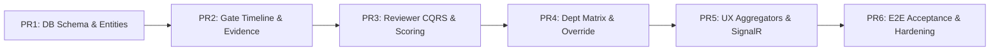

# 11 — BACKEND DEVELOPER IMPLEMENTATION TASKS (PR1 – PR6)
**AI-PMS (Academic Information & Project Management System)**  
**Target Architecture:** ASP.NET Core 9 Clean Architecture + MediatR CQRS + EF Core Database-First  
**Traceability Reference:** `PLAN-QUAN-LY-TIEN-TRINH-REVIEW-2026-10-16.md` & `review-gates-backend-implementation-handoff.md`  

---

## 1. Roadmap Overview & PR Sequencing

The backend development work is partitioned into six atomic, testable Pull Requests (PR1 – PR6). Each PR must pass automated CI checks without breaking existing tests.

---

## 2. Detailed PR Task Specifications

### PR1 — Database Schema Migration & Core Domain Entities
- **Objective:** Deploy database migration V061, define Clean Architecture domain entities, value objects, and EF Core configurations.
- **Repository Path:** `ai-pms-backend`
- **Tasks:**
  1. Add migration script `db/changes/V061__create_review_gates_schema.sql` (from Document 09).
  2. Implement Domain Entities in `src/AIPMS.Domain/Entities/ReviewGates/`:
     - `ReviewGateTemplate.cs`
     - `GateTemplateCriteria.cs`
     - `ProjectGateInstance.cs`
     - `GateEvidenceLedger.cs`
     - `GateReviewerAssignment.cs`
     - `GateEvaluation.cs`
     - `GateEvaluationScore.cs`
     - `GateAuditLog.cs`
     - `ProjectAffiliatedDepartment.cs`
  3. Implement EF Core Configurations in `src/AIPMS.Infrastructure/Data/Configurations/ReviewGates/`:
     - Map entity properties, foreign keys with `DeleteBehavior.Restrict`/`NoAction`.
     - Configure `.IsRowVersion()` on `RowVersion` properties.
  4. Register DbSets in `IAipmsDbContext.cs` and `AipmsDbContext.cs`.
- **Definition of Done (DoD):** EF Core migration compiles, `DbContext` runs in-memory integration test without model validation errors.

---

### PR2 — Gate Query Services, Timeline & Evidence Ledger API
- **Objective:** Enable student workspace to view gate timelines, KPIs, and upload/manage evidence ledger items.
- **Tasks:**
  1. Implement CQRS Queries in `src/AIPMS.Application/Features/ReviewGates/Queries/`:
     - `GetProjectReviewGatesQuery.cs` -> Computes KPI cards (Clearance Rate, Evidence Score, Blockers, Next Deadline) and returns chronological gate list.
     - `GetGateEvidenceLedgerQuery.cs` -> Retrieves evidence items for a specific gate instance.
  2. Implement CQRS Commands in `src/AIPMS.Application/Features/ReviewGates/Commands/`:
     - `SubmitGateEvidenceCommand.cs` + FluentValidator (enforces file types, size, valid URLs, and `UtcNow <= DeadlineUtc`).
     - `DeleteGateEvidenceCommand.cs` (enforces Student Leader role and `Status != UNDER_REVIEW`).
     - `SubmitGateForReviewCommand.cs` (verifies all mandatory evidence uploaded, transitions status to `UNDER_REVIEW`).
  3. Implement Controller:
     - Create `src/AIPMS.Api/Controllers/ProjectReviewGatesController.cs` exposing routes defined in Document 05.
- **Definition of Done (DoD):** Students can upload files, view timelines, and submit gates for review via Postman / Swagger.

---

### PR3 — Reviewer Assignment, Conflict Isolation & Scoring Engine
- **Objective:** Enable Department Head to assign independent reviewers and enable reviewers to score gates with automatic consensus calculation.
- **Tasks:**
  1. Implement Reviewer Assignment CQRS:
     - `AssignGateReviewerCommand.cs` + Validator.
     - **Enforce Invariant `BR-GATE-028`:** Fail with `ERR_REVIEWER_CONFLICT_OF_INTEREST` if reviewer ID matches project supervisor or co-supervisor.
  2. Implement Reviewer Scoring CQRS:
     - `SubmitGateEvaluationCommand.cs` (handles `isDraft: true` vs `isDraft: false`).
     - Calculates weighted average score: $\sum (\text{criterion.score} \times \text{criterion.weight})$.
  3. Implement Gate Consensus Evaluator (`GateConsensusEvaluationService.cs`):
     - When all assigned reviewers have finalized scoring, calculate aggregate score.
     - Automatically transition gate to `PASSED`, `REVISION_REQUIRED`, or `FAILED` per `BR-GATE-030`.
     - Publish `GatePassedDomainEvent` or `GateRevisionRequiredDomainEvent`.
  4. Implement Controller:
     - Create `src/AIPMS.Api/Controllers/ReviewerGateEvaluationsController.cs`.
- **Definition of Done (DoD):** Reviewers can submit draft and final scores; conflicting supervisors are rejected; gate status transitions automatically upon final review.

---

### PR4 — Department Gate Matrix, Cohort Aggregation & Override Mechanics
- **Objective:** Provide Department Heads with high-density cohort monitoring and emergency override authority.
- **Tasks:**
  1. Implement Matrix Query:
     - `GetDepartmentGateMatrixQuery.cs` in `src/AIPMS.Application/Features/ReviewGates/Queries/`.
     - Implement high-performance SQL projection using compiled EF Core query or Dapper to retrieve 100+ projects with 4 gates in $< 150\text{ms}$.
  2. Implement Department Head Override Command:
     - `OverrideGateDecisionCommand.cs` (restricted to `DEPARTMENT_HEAD` policy).
     - Validates mandatory justification string ($\ge 50$ chars).
     - Updates `ProjectGateInstance.Status = OVERRIDDEN_PASSED` and inserts immutable record in `dbo.GateAuditLogs`.
  3. Implement Gate Template Builder:
     - `CreateGateTemplateCommand.cs` / `UpdateGateTemplateCommand.cs`.
  4. Implement Controller:
     - Create `src/AIPMS.Api/Controllers/DepartmentReviewGatesController.cs`.
- **Definition of Done (DoD):** Department Head can view full cohort matrix, apply filters by major, and successfully execute gate overrides.

---

### PR5 — Composite UX Aggregators & SignalR Realtime Push
- **Objective:** Eliminate frontend multiple-round-trip waterfall requests and enable real-time UI updates.
- **Tasks:**
  1. Implement Composite Aggregators:
     - `GetStudentNextActionsQuery.cs` -> Single call returning project stage, next upcoming deadlines, and urgent action queue.
     - `GetSupervisorTriageQueueQuery.cs` -> Aggregates proposals, pending weekly reviews, and meeting sign-offs.
     - `GetDepartmentUrgentActionsQuery.cs` -> Returns pending overrides, unassigned reviewers, and open appeals.
  2. Implement SignalR Event Handlers:
     - Create MediatR handlers in `src/AIPMS.Infrastructure/Hubs/Handlers/` for all Document 10 domain events.
     - Push typed messages via `IHubContext<NotificationHub>`.
- **Definition of Done (DoD):** FE Next Action widget loads with single request; real-time toast notifications appear when status changes.

---

### PR6 — Acceptance Test Suites & Production Hardening
- **Objective:** Verify end-to-end multi-role workflows with automated integration tests.
- **Tasks:**
  1. Implement xUnit Integration Test Suite: `AIPMS.IntegrationTests/ReviewGates/`:
     - Test Scenario 1: Single-Major Software Engineering Lifecycle.
     - Test Scenario 2: Interdisciplinary IT + Marketing + Graphic Design Lifecycle.
  2. Implement Concurrency Stress Test:
     - Simulate 5 concurrent reviewer submissions to verify `RowVersion` optimistic concurrency handling.
  3. Swagger Documentation & Security Audit:
     - Ensure all endpoints document XML comments, response codes (200, 400, 403, 404, 409, 422), and JWT security requirements.
- **Definition of Done (DoD):** 100% test pass rate in CI, 0 build warnings, OpenAPI spec verified against FE contract.
