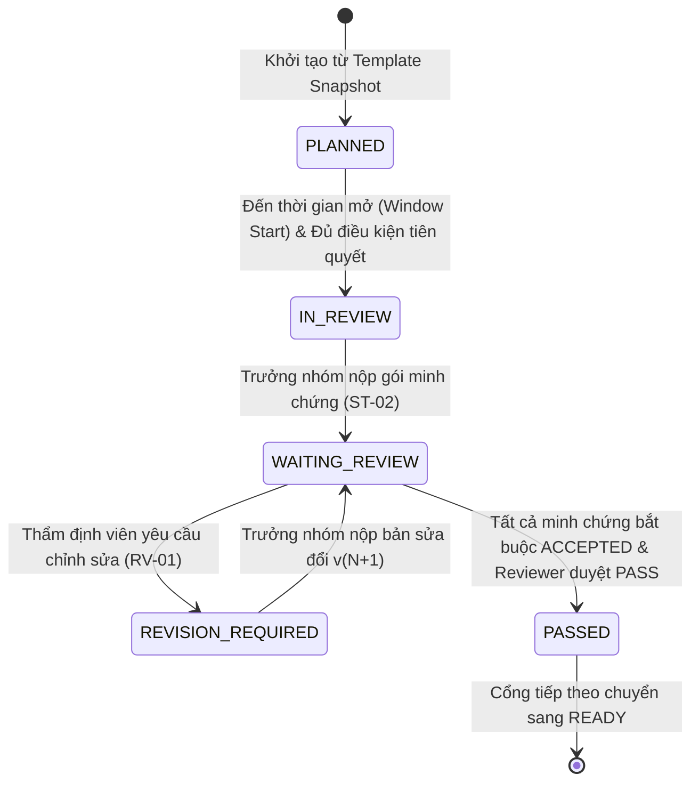

# GÓI BÀN GIAO THỰC THI BACKEND (BE IMPLEMENTATION PACKAGE)

**Dự án:** AI-PMS (Academic Capstone Project Management System)  
**Tài liệu tham chiếu:** `01_ANTIGRAVITY_MASTER_PROMPT.md`, `04_BE_BR_HANDOFF_SEED.md`, `06_ROLE_EVENTS_AND_TRACEABILITY.md`.  
**Nhánh Git:** `feat/uiux-master-redesign` | **Commit cơ sở:** `e9e0d14c5696158550ffdf270963db44c1885ea9`  
**Ngày phát hành:** 2026-10-17 | **Tác giả:** Antigravity Architect & Senior Academic BA.

---

## MỤC LỤC
1. [Tổng quan Kiến trúc & Nguyên tắc cốt lõi](#1-tổng-quan-kiến-trúc--nguyên-tắc-cốt-lõi)
2. [Vòng đời Dự án & Máy trạng thái Cổng thẩm định](#2-vòng-đời-dự-án--máy-trạng-thái-cổng-thẩm-định)
3. [Quy chế Tính toán Tiến độ Độc lập (Progress Invariants)](#3-quy-chế-tính-toán-tiến-độ-độc-lập-progress-invariants)
4. [Đồ án Liên ngành & Cơ chế Khóa Cổng tích hợp (Hybrid Integration Gate)](#4-đồ-án-liên-ngành--cơ-chế-khóa-cổng-tích-hợp-hybrid-integration-gate)
5. [Kiến trúc Thông báo Lưu trữ & Outbox Pattern (SRS §3.14)](#5-kiến-trúc-thông-báo-lưu-trữ--outbox-pattern-srs-314)
6. [Lộ trình Triển khai Phía Backend theo Phụ thuộc (PR1 → PR6)](#6-lộ-trình-triển-khai-phía-backend-theo-phụ-thuộc-pr1--pr6)

---

## 1. TỔNG QUAN KIẾN TRÚC & NGUYÊN TẮC CỐT LÕI

Gói bàn giao này định nghĩa chi tiết tất cả các quy tắc nghiệp vụ, thực thể dữ liệu, API contracts và sự kiện miền cần thiết để đội ngũ Backend (ASP.NET Core / Entity Framework Core / SQL Server) triển khai hệ thống **Quản lý Tiến độ Học vụ & Cổng Kiểm soát Chất lượng (Review Gates & Academic Progress)** tương thích 100% với Frontend hiện tại.

### Các Nguyên tắc Bất biến Bắt buộc (Non-negotiable Rules)
1. **Phân định rạch ròi 4 khái niệm:**
   - *Trạng thái Đồ án (Project State):* `REGISTERED → IN_PROGRESS → FINAL_SUBMISSION → COMPLETED / ARCHIVED`.
   - *Trạng thái Cổng Thẩm định (Review Gate Status):* `PLANNED → IN_REVIEW → PASSED / REVISION_REQUIRED / LOCKED`.
   - *Xác minh Minh chứng (Evidence Verification):* `PENDING → SUBMITTED → ACCEPTED / REJECTED`.
   - *Đủ điều kiện Bảo vệ (Defense Readiness):* `READY` hoặc `NOT_READY` (mô hình đọc tư vấn - Advisory Read Model, không tự ý khóa cổng nộp cuối kỳ khi chưa có phê duyệt học vụ).
2. **Nộp bài KHÔNG đồng nghĩa với Hoàn thành Cổng:** Khi Trưởng nhóm nộp minh chứng, cổng chuyển sang `WAITING_REVIEW`. Tiến độ học vụ KHÔNG được tăng cho đến khi có quyết định phê duyệt ĐẠT (`PASSED`) chính thức từ Thẩm định viên được phân công.
3. **Phân tách hoàn toàn Tiến độ Task và Tiến độ Học vụ:**
   - 90% hoàn thành task kỹ thuật trên Task Board không làm thay đổi tiến độ học vụ.
   - Tiến độ học vụ tính bằng: `100 × Tổng trọng số các Cổng đã ĐẠT / Tổng trọng số các nhánh đã chốt snapshot`.
4. **Ảnh chụp Snapshot Đồ án Bất biến (Frozen Project Process Snapshot):** Khi đồ án chuyển sang `ACTIVE`, hệ thống đóng băng một bản snapshot quy trình từ Template đã được ban hành (`PUBLISHED`). Các chỉnh sửa template sau đó không được làm thay đổi đồ án đang chạy.

---

## 2. VÒNG ĐỜI DỰ ÁN & MÁY TRẠNG THÁI CỔNG THẨM ĐỊNH

### Luồng Chuyển dịch Trạng thái Cổng (Gate State Machine)

---

## 3. QUY CHẾ TÍNH TOÁN TIẾN ĐỘ ĐỘC LẬP (PROGRESS INVARIANTS)

1. **Công thức Toán học:**
   $$\text{Progress}_{\text{Academic}} = \frac{\sum \text{Weight of PASSED Gates}}{\text{Total Frozen Weight}} \times 100\%$$
2. **Trường hợp chưa cấu hình hoặc thiếu dữ liệu:**
   - Trả về `progressPercent: null` kèm mã `NOT_CONFIGURED` hoặc `INSUFFICIENT_DATA`.
   - Tuyệt đối không giả mạo số `0%` hoặc `100%`.
3. **Mẫu thực nghiệm (Golden Samples):**
   - Đơn ngành IT [R1: 20%, R2: 20%, R3: 35%, R4: 25%]:
     - Đạt R1 + R2: Tiến độ chính xác là **40%**.
     - Đang nộp R3 (`WAITING_REVIEW`): Tiến độ vẫn là **40%**.
     - Reviewer duyệt ĐẠT R3: Tiến độ tăng lên **75%** duy nhất một lần.
     - Task board báo 100% xong việc: Tiến độ học vụ vẫn giữ nguyên **75%**.

---

## 4. ĐỒ ÁN LIÊN NGÀNH & CƠ CHẾ KHÓA CỔNG TÍCH HỢP (HYBRID INTEGRATION GATE)

1. **Một đồ án duy nhất:** Không tạo 3 đồ án con cho 3 ngành.
2. **Đa nhánh chuyên môn:**
   - Nhánh Chung (Common): Trọng số 40%.
   - Nhánh Kỹ thuật Phần mềm (IT): Trọng số 20%.
   - Nhánh Marketing: Trọng số 20%.
   - Nhánh Thiết kế Đồ họa (Design): Trọng số 20%.
3. **Khóa Cổng tích hợp:** Cổng đánh giá tích hợp cuối cùng (`Integration Gate`) bị khóa (`LOCKED / NOT_READY`) nếu bất kỳ bộ môn thành viên nào (Marketing hoặc Design) chưa duyệt ĐẠT nhánh chuyên môn của họ.

---

## 5. KIẾN TRÚC THÔNG BÁO LƯU TRỮ & OUTBOX PATTERN (SRS §3.14)

1. **Lưu trữ Bền vững (Persistent In-App):** Thông báo được lưu vào bảng cơ sở dữ liệu `Notifications`, không phụ thuộc vào WebSocket tạm thời.
2. **Sự kiện sau Commit (Transaction Commit):** Chỉ phát sinh bản ghi outbox sau khi giao dịch cơ sở dữ liệu của quyết định thẩm định đã commit thành công.
3. **Xác thực lại Quyền tại Deep-Link:** Khi người dùng click vào thông báo dẫn tới `/project/timeline` hoặc `/review/gate-assignments`, hệ thống phải xác thực lại phân quyền hiện tại của người dùng. Nếu vai trò thẩm định viên đã bị thu hồi, hệ thống trả về `403 Forbidden`.

---

## 6. LỘ TRÌNH TRIỂN KHAI PHÍA BACKEND THEO PHỤ THUỘC (PR1 → PR6)

- **PR1 — Database Schema & Migrations:** Tạo 7 bảng cơ sở dữ liệu (`ReviewGateTemplates`, `ReviewGates`, `GateRequirements`, `ProjectProcessSnapshots`, `ProjectGateInstances`, `GateArtifactSubmissions`, `ReviewGateAudits`).
- **PR2 — Department Template Management API:** Triển khai các endpoint CRUD và Publish cho DS-01 & DS-02.
- **PR3 — Snapshot Engine & Matrix Monitoring API:** Triển khai cơ chế đóng băng quy trình khi project ACTIVE và API ma trận tiến độ DS-03.
- **PR4 — Student Review Submission & Versioning API:** Triển khai API cho Leader nộp minh chứng, kiểm tra quyền hạn (ST-01, ST-02, ST-03).
- **PR5 — Reviewer Verification & Gate Decision Engine:** Triển khai API xác minh minh chứng và phê duyệt cổng có kiểm tra concurrency token (RV-01).
- **PR6 — Notification Outbox & Advisory Defense Readiness API:** Tích hợp bộ phát sự kiện outbox và tính toán điều kiện bảo vệ (DEF-01, NT-01).
