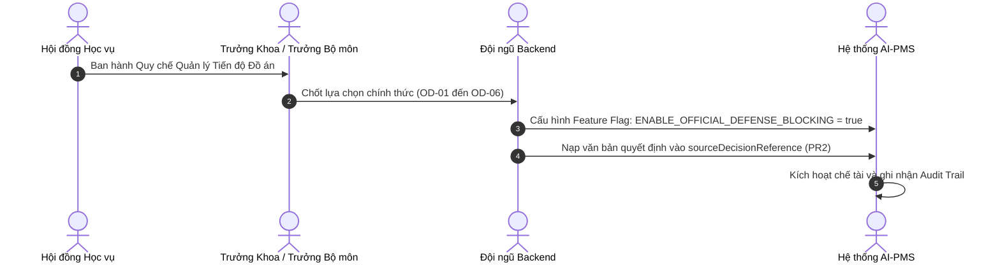

# BẢNG TẬP HỢP CÁC QUYẾT ĐỊNH NGHIỆP VỤ HỌC VỤ ĐANG CHỜ PHÊ DUYỆT (OPEN ACADEMIC DECISIONS)

**Dự án:** AI-PMS (Academic Capstone Project Management System)  
**Tài liệu tham chiếu:** `01_ANTIGRAVITY_MASTER_PROMPT.md`, `04_BE_BR_HANDOFF_SEED.md`, `BE_IMPLEMENTATION_PACKAGE.md`  
**Nhánh Git:** `feat/uiux-master-redesign` | **Commit:** `e9e0d14c5696158550ffdf270963db44c1885ea9`  
**Ngày phát hành:** 2026-10-17  
**Vai trò:** Senior Academic Business Analyst & Frontend Architect  

---

## 1. TỔNG QUAN

Tài liệu này ghi nhận toàn bộ các quyết định học vụ (Open Academic Decisions) có tính chất cốt lõi ảnh hưởng đến quy trình vận hành của hệ thống AI-PMS. 

Theo nguyên tắc bất biến tại `01_ANTIGRAVITY_MASTER_PROMPT.md`:
> *"Hệ thống không được tự ý biến một đề xuất kỹ thuật, wireframe thử nghiệm hoặc giá trị mock thành quy chế học vụ bắt buộc. Mọi tính năng mang tính chế tài hoặc phân loại tốt nghiệp phải căn cứ trên quyết định chính thức bằng văn bản của Hội đồng Học vụ."*

Frontend hiện tại đã được thiết kế theo hướng **Mô hình Đọc Tư vấn (Advisory Read Model)**: không tự ý khóa cứng quyền nộp bài của sinh viên nếu chưa có quyết định phê duyệt bằng văn bản.

---

## 2. MA TRẬN QUYẾT ĐỊNH HỌC VỤ (DECISION MATRIX)

| Quyết định ID | Vấn đề / Khía cạnh nghiệp vụ | Lựa chọn A | Lựa chọn B (Khuyến nghị kỹ thuật) | Cấp thẩm quyền quyết định | Trạng thái | Mức độ rủi ro | Tính năng / Module bị ảnh hưởng |
|---|---|---|---|---|---|---|---|
| **OD-01** | **Chế tài Đủ điều kiện Bảo vệ (Defense Blocking):** Cổng thẩm định không ĐẠT có tự động khóa nộp bài đồ án cuối kỳ không? | Khóa cứng tuyệt đối: Hệ thống tự động từ chối nộp đồ án nếu còn cổng chưa `PASSED`. | **Mô hình Tư vấn có Ngoại lệ:** Cảnh báo `NOT_READY`, chặn mặc định nhưng cho phép Giáo vụ / Chủ nhiệm bộ môn cấp quyền nộp ngoại lệ (Waiver with Audit). | Hội đồng Đào tạo Trường / Trưởng phòng Đào tạo | `PROPOSED (Chờ duyệt)` | **CAO** (Ảnh hưởng quyền lợi tốt nghiệp của sinh viên) | DEF-01, ST-01, Final Submission API |
| **OD-02** | **Cơ chế Phân bổ Trọng số Đồ án Liên ngành:** Tỷ lệ % giữa nhánh Chung và các bộ môn chuyên ngành. | Cố định cứng: Chung 40%, mỗi ngành thành viên 20% (áp dụng toàn trường). | **Cấu hình Động theo Quyết định Đồ án:** Cho phép Trưởng bộ môn chủ trì cấu hình trọng số theo từng kỳ học và ngành liên kết (tổng = 100%). | Trưởng các Khoa liên ngành liên quan | `PROPOSED (Đã có mẫu demo)` | **TRUNG BÌNH** (Tranh chấp quyền biểu quyết giữa các khoa) | DS-01, DS-02, BRX-PROC-06, BRX-PRG-04 |
| **OD-03** | **Tỷ lệ Đóng góp Cá nhân vs Điểm Học phần:** Task hoàn thành thấp có tự động cấm bảo vệ cá nhân? | Tự động cấm: Thành viên có % đóng góp < 50% bị trượt đồ án tự động. | **Tách biệt Đánh giá Chuyên môn:** Đóng góp cá nhân chỉ là chỉ số tham khảo cho GVHD; điểm học phần do Hội đồng chấm theo Rubric độc lập. | Ban Đảm bảo Chất lượng Học vụ | `PROPOSED (FE đã tách biệt)` | **CAO** (Rủi ro thiên vị thuật toán và khiếu nại điểm số) | BRX-PRG-07, Member Task Workspace |
| **OD-04** | **Quyền Hạn của Chuyên gia Doanh nghiệp / Đồng Hướng dẫn:** Có được quyền chốt quyết định ĐẠT/KHÔNG ĐẠT Cổng thẩm định không? | Bình quyền: Chuyên gia doanh nghiệp có quyền bấm duyệt `PASSED` như giảng viên cơ hữu. | **Ý kiến Tư vấn Chuyên môn:** Chuyên gia gửi ý kiến nhận xét (`FEEDBACK`); chỉ Giảng viên cơ hữu hoặc Thẩm định viên được phân công mới chốt quyết định chính thức. | Hội đồng Khoa học & Đào tạo Khoa | `PROPOSED (Đang áp dụng B)` | **TRUNG BÌNH** (Trách nhiệm pháp lý học vụ của nhà trường) | RV-01, BRX-RG-07, Concurrency ETag |
| **OD-05** | **Giới hạn Số lần Sửa đổi Minh chứng (Revision Limit):** Cổng bị yêu cầu sửa đổi (`REVISION_REQUIRED`) tối đa mấy lần? | Tối đa 2 lần; lần thứ 3 tự động chuyển đồ án sang trạng thái `FAILED`. | **Tối đa 2 lần trong khung thời gian; vượt quá chuyển Giáo vụ can thiệp:** Không tự động hủy đồ án mà thông báo escalation lên Khoa. | Ban Chủ nhiệm Khoa | `PROPOSED (Đang áp dụng B)` | **TRUNG BÌNH** (Nguy cơ nghẽn quy trình chấm xét) | BRX-RG-08, BRX-RG-10, Notification Outbox |
| **OD-06** | **Chính sách Hồi cứu Đồ án Khóa trước (Legacy Project Backfill):** Các đồ án kỳ cũ chưa có Cổng thẩm định hiển thị tiến độ ra sao? | Tự động giả lập 100% dựa trên danh sách task đã đóng. | **Hiển thị `NULL` kèm nhãn phân loại:** Hiển thị `Chưa áp dụng quy chế Cổng mới` (`NOT_CONFIGURED`), tuyệt đối không bịa số 0% hay 100%. | Trưởng Phòng Đào tạo & Quản trị Hệ thống | `PROPOSED (Bất biến kỹ thuật)` | **THẤP** (Đảm bảo tính trung thực của kiểm toán dữ liệu) | DS-03, ST-01, BRX-PROC-11 |

---

## 3. CHI TIẾT CÁC QUYẾT ĐỊNH & KHUYẾN NGHỊ

### OD-01: Chế tài Đủ điều kiện Bảo vệ (Defense Blocking Enforcement)
- **Bối cảnh:** Hiện tại màn hình `StudentReviewTimeline.tsx` và `DEF-01` hiển thị Modal điều kiện bảo vệ tư vấn (`Advisory Defense Readiness Modal`). Nếu sinh viên có cổng thẩm định chưa đạt, hệ thống hiển thị danh sách các điều kiện còn thiếu (ví dụ: `Missing: Architecture Design Gate`, `Missing: Supervisor Sign-off`).
- **Phân tích rủi ro:** Nếu Backend tự động chặn (Hard-block) API nộp bài cuối kỳ `POST /api/projects/{id}/final-submission` với mã `403/422`, các trường hợp sinh viên được hội đồng cho phép nộp bổ sung sau bảo vệ hoặc có lý do đặc biệt (bảo lưu y tế) sẽ bị tắc nghẽn kỹ thuật hoàn toàn.
- **Khuyến nghị của Đội ngũ Kỹ thuật:**
  1. Mặc định FE hiển thị cảnh báo đỏ và vô hiệu hóa nút nộp bài thông thường.
  2. Bổ sung endpoint Giáo vụ: `POST /api/projects/{id}/defense-readiness/override` với `reason` bắt buộc và lưu vết `ReviewGateAudits`.
  3. Chỉ kích hoạt chặn cứng khi có văn bản quy định chính thức của Hiệu trưởng ký ban hành.

### OD-02: Cơ chế Phân bổ Trọng số Đồ án Liên ngành
- **Bối cảnh:** Đồ án liên ngành kết hợp giữa Công nghệ Thông tin, Marketing số và Thiết kế Mỹ thuật số.
- **Vấn đề cạnh tranh:** Khoa CNTT cho rằng khối lượng code chiếm 50%, nhưng Khoa Thiết kế cho rằng bộ nhận diện thương hiệu và UI/UX cần ít nhất 30%.
- **Khuyến nghị của Đội ngũ Kỹ thuật:** Không mã hóa cứng (hardcode) công thức `40/20/20/20` trong code. Bảng `ProjectProcessSnapshots` đã hỗ trợ cấu hình mảng JSON đa nhánh linh hoạt. Mỗi Khoa có thể đàm phán tỷ lệ này khi ban hành Template cho đợt làm đồ án cụ thể.

### OD-03: Tách biệt Đóng góp Cá nhân và Điểm Học phần
- **Bối cảnh:** Task Board (Scrum/Kanban) ghi nhận bạn A làm 12 tasks (80%), bạn B làm 2 tasks (20%).
- **Vấn đề pháp lý:** Trong đồ án phần mềm, bạn B có thể đảm nhiệm việc nghiên cứu thuật toán cốt lõi (1 task rất khó), trong khi bạn A làm các màn hình CRUD (nhiều task nhỏ).
- **Khuyến nghị của Đội ngũ Kỹ thuật:** Hệ thống hiển thị Task Completion để phục vụ quản lý nội bộ nhóm và cảnh báo sớm nguy cơ trễ hạn. Điểm số cá nhân cuối cùng phải do Thầy Cô chấm bảo vệ chấm trên thang Rubric chuẩn quốc gia, không cho phép hệ thống tự động suy diễn điểm học bạ từ số lượng click chuột.

---

## 4. QUY TRÌNH KÝ DUYỆT & KÍCH HOẠT QUY CHẾ

---

## 5. KẾT LUẬN & BƯỚC TIẾP THEO CHO ĐỘI NGŨ BACKEND
- Trong giai đoạn triển khai **PR1 đến PR5**, đội ngũ Backend lập trình theo cơ chế **Mô hình Tư vấn (Option B)** cho tất cả các quy định trên để đảm bảo tính an toàn và tương thích tối đa với Frontend.
- Khi Hội đồng Học vụ có văn bản chính thức cho bất kỳ quy chế nào, Backend chỉ cần bật cờ cấu hình tương ứng mà không phải tái cấu trúc lại cơ sở dữ liệu.
