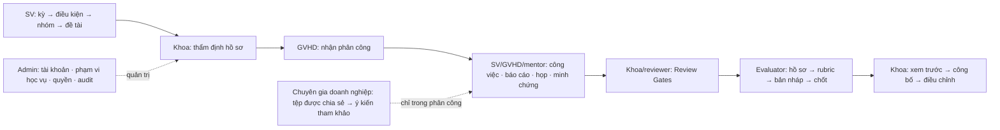

# AI-PMS — phân tích sâu Workspace, tương tác vai trò và bản đồ truy cập

**Ngày:** 13/11/2026 · **FE:** `feat/fe-fresearch-reference-20261113` tại `4b31ff2` trước các sửa trong tài liệu này · **BE đối chiếu chỉ đọc:** `F:\AI-PMS\ai-pms-backend-audit-20261113` tại `210e9eb` (`origin/develop`). **Bàn giao:** cùng nhánh FE đã push, commit nhỏ; không PR/merge/deploy.

## 1. Kết luận điều tra và giới hạn bằng chứng

Ảnh FAMS người dùng gửi là **bản đồ địa lý vị trí truy cập**, có nhóm số liệu, chấm vị trí và danh sách lượt truy cập gần đây; không phải sơ đồ tổ chức hoặc ma trận quyền. Chỉ học **bố cục bản đồ ↔ danh sách đồng bộ, mức độ ưu tiên thông tin và trạng thái có chữ**. Màu, logo, dữ liệu và cách gọi trạng thái giữ của AI-PMS. Ảnh `image88.png` trong FAMS catalog là mẫu ma trận phân quyền, `image234.png` là sơ đồ tầng; không dùng chúng làm bằng chứng cho bản đồ truy cập.

Router FE đã sinh [`139 route`](ROUTE_INVENTORY.generated.md). Đây là **route catalog**, chưa phải 139 màn đã audit trình duyệt. Nhánh có logo, palette sáng, thay đổi ở Period/Team/Topic và loading mascot; **không có bằng chứng 11 work package trong [plan trước](AI_PMS_SYSTEMWIDE_UIUX_EXECUTION_PLAN_2026-11-13.md) đã hoàn tất toàn hệ thống**. Kế hoạch này tiếp tục từ trạng thái code thật, không đánh dấu các màn chưa chạy là xong.

| Bằng chứng từ code | Kết luận | Mức |
|---|---|---|
| `UsersController.GetUsers` + `UserAccountDto.LastLoginAt` | Admin có danh sách tài khoản, trạng thái tài khoản và **lần đăng nhập cuối**, chưa có thời lượng online | VERIFIED |
| `AuditLogsController.GetAuditLogs` + `AuditRecordDto.IpAddress/OccurredAt` | Admin có log hành động theo trang và IP; `GetAuditLogsQueryHandler` gọi `EnsureAdministrator()` | VERIFIED |
| `AcademicProfilesController.List` + `GetAcademicProfilesHandler` | Bộ môn được BE giới hạn `managedDepartment`; đây là hồ sơ học vụ, không phải danh sách mọi phiên truy cập | VERIFIED |
| `SupervisorsController.List` + `GetSupervisorsQuery` | API giảng viên có `departmentId`, nhưng FE trước sửa gọi không lọc trong `DepartmentWorkspacePage`; `SupervisorMonitoringPage` còn bộ lọc mã bộ môn tự nhập | VERIFIED |
| `ChatConnections` | Chỉ phản ánh kết nối chat, không phải phiên đăng nhập online của toàn app | VERIFIED về phạm vi code; chưa thử runtime |
| Tìm controller/DTO trong BE `210e9eb` | Chưa thấy endpoint tọa độ/thành phố hoặc đếm online toàn hệ thống; `LastLoginAt`/log không thể tạo chấm online thật | VERIFIED trên source, chưa khẳng định mọi hạ tầng ngoài repo |

**Không thể vẽ bản đồ người dùng thật từ FE hiện tại.** Dùng tọa độ tĩnh hoặc tự gửi IP từng người sang dịch vụ bản đồ từ trình duyệt sẽ tạo dữ liệu sai và mở rộng lộ thông tin. Thiết kế bản đồ là một hạng mục BE+FE có contract và kiểm thử quyền riêng. Trong lúc đó vẫn cải thiện được danh sách, phạm vi, thời điểm đăng nhập thật và trạng thái lỗi của các workspace.

## 2. Hành trình xuyên vai trò và điểm bàn giao



| Vai trò / workspace | Câu hỏi người dùng cần trả lời ngay | Hành động và handoff có thẩm quyền | Kiểm tra sâu tiếp theo |
|---|---|---|---|
| Sinh viên: Period, Team, Topic, Project Workspace | Tôi đang ở đợt nào, đủ điều kiện chưa, ai chờ ai, hạn nào kế tiếp? | Đăng ký/điều chỉnh theo BE; khi ACTIVE chuyển nhiệm vụ, mốc, báo cáo, tệp | Điều kiện đơn/liên ngành; lịch sử revise; blocked/empty; leader/member; mobile |
| GVHD chính: dashboard, inbox, project workspace | Nhóm nào cần phản hồi, mình được phân công ở đâu, việc gì trễ? | Nhận/từ chối, xem báo cáo, họp, Gate, final checklist; chỉ ký trong scope | Pending → decided; stale request; lý do bị khóa; nhiều đồ án; deep link |
| Mentor chuyên ngành | Mình phụ trách ngành nào trong đồ án liên ngành? | Theo dõi task/report/meeting trong `majorId` được giao | Không nhìn/đổi scope ngành khác; ended assignment; lỗi tải riêng |
| Reviewer/Evaluator | Hồ sơ/tệp phiên bản nào, scope/rubric/stage nào, bản nháp hay đã chốt? | Gate review; điểm theo assignment, không tự suy điểm thiếu | 403 direct link, PENDING ≠ 0, conflict, version/tệp, finalized readonly |
| Khoa/bộ môn (`DEPARTMENT_STAFF`) | Đợt nào tắc, hồ sơ nào chờ, thành viên nào thuộc phạm vi mình? | Thẩm định, theo dõi, phân công, công bố trong quyền BE | Scope theo server; queue, pagination/counter; các quyết định liên bộ môn |
| Admin | Tài khoản/vai trò nào, lần truy cập nào, quyền toàn hệ thống? | Account/security/academic config/audit; không thay phân công đồ án từ màn quyền | Tìm/lọc, last login, action audit, URL tab, 401/403; map sau contract |
| Chuyên gia doanh nghiệp | Đồ án nào được chia sẻ, tệp và ý kiến nào thuộc phân công hiện tại? | Tải tệp, gửi ý kiến advisory nếu `allowedActions` cho phép | Chuyển phân công nhanh, lỗi một phần, pagination, phiên bản nhận xét |

## 3. Phát hiện ưu tiên từ việc đọc source và sửa ngay

| ID | Mức | Bề mặt và bằng chứng | Hậu quả | Việc hiện tại |
|---|---|---|---|---|
| F01 | P1 | `DepartmentWorkspacePage`: `listSupervisors(token,{page,pageSize})` bỏ `departmentId` | Tile “Giảng viên” lấy tổng toàn trường trên trang bộ môn | Đã sửa FE: truy vấn từng bộ môn trong context, cộng `totalCount`, không gọi khi thiếu scope; test âm/dương |
| F02 | P1 | `IndustryExpertPortalPage`: `loadDetails` ghi state sau Promise bất kể selection mới; catch bỏ lỗi | Tài liệu/ý kiến đồ án cũ có thể hiện ở đồ án mới; lỗi trông như rỗng | Đã sửa FE: request generation, reset theo assignment, lỗi tài liệu/lịch sử riêng, chặn submit nếu history chưa tải; tests race/error |
| F03 | P1 a11y | Danh sách đồ án chuyên gia dùng `<li onClick>` | Không chọn bằng Tab/Enter | Đã đổi sang button có `aria-pressed`, focus ring và vùng chạm |
| F04 | P2 | Admin `tab` URL được cast trực tiếp, giá trị lạ ẩn cả 2 panel | Link hỏng tạo trang trống | Đã fallback về accounts, thêm `aria-controls/aria-pressed`, test |
| F05 | P2 | BE `UserAccountDto.LastLoginAt` đã có, FE không hiển thị | Admin thiếu dữ kiện truy cập gần nhất | Đã thêm cột “Đăng nhập gần nhất” theo giờ VN; không gọi là online |
| F06 | P2 | Portfolio export tải tên `pms-portfolio` | Nhận diện cũ trong file người dùng | Đã đổi `aipms-portfolio` |
| F07 | FE đã sửa; BE cần rà quyền | `SupervisorMonitoringPage` cho nhập `departmentId` tự do; hook mặc định gọi list toàn trường | Màn bộ môn tuyên bố phạm vi bộ môn nhưng hiển thị rộng | FE đã lấy bộ môn từ workflow context, lọc selector, chặn hiển thị detail ngoài scope và loại response cũ; BE `GetSupervisorsQueryHandler` hiện chỉ kiểm tra tài khoản active qua `SupervisorAccessService.EnsureCanReadAsync`, cần xác định chính sách đọc profile cho từng role |
| F08 | FE đã sửa; cần browser QA | Industry list chỉ đọc trang đầu 50; tệp và lịch sử chỉ đọc trang đầu API | Phân công/tệp/ý kiến sau trang đầu biến mất | Đã thêm “Xem thêm” từng danh sách và lỗi trang tiếp theo riêng; cần thử trang lớn và thay đổi dữ liệu đồng thời trên runtime |
| F11 | P1 đã sửa | BE `IndustryService.Map` trả action `SUBMIT_FEEDBACK`; FE kiểm `FEEDBACK` | Chuyên gia có quyền nhưng nút gửi bị vô hiệu | Đã dùng đúng action từ BE và thêm test |
| F12 | P1 đã sửa | BE `IndustryService.Feedback` so `ExpectedVersion` với phiên bản **hiện tại** và đổi `ConcurrencyToken` sau ghi; FE gửi `latestVersion + 1` rồi refresh trang đầu | Gửi ý kiến bị 409 hoặc token cũ cho lần kế tiếp; mất selection sau trang đầu | Đã gửi phiên bản hiện tại, đọc lại assignment theo ID và khóa gửi tiếp nếu không làm mới được token |
| F09 | P1 còn mở | 139 route; hiện chỉ có bằng chứng browser hạn chế ở audit trước | Không thể tuyên bố UI toàn hệ thống đạt chuẩn | Cần ma trận route × role × state × viewport và chụp bằng dữ liệu hợp lệ |
| F10 | P1 phụ thuộc BE | Chưa có geo/online/scope endpoint | Map như ảnh sẽ bịa vị trí hoặc quyền | RFC ở mục 5; không bật FE map trước contract |

Các sửa F01–F08/F11–F12 dùng contract đã có, không đổi route hay nghiệp vụ. F07 chỉ hạn chế FE; **BE vẫn là ranh giới phân quyền** và cần quyết định riêng nếu supervisor profile là dữ liệu giới hạn theo bộ môn. Unit/component test không thay thế được authenticated browser QA. Lint còn warning từ nhiều file trước; không ghi “lint sạch warning”.

## 4. Thư viện/công cụ cho bản đồ địa lý

| Lựa chọn | Phù hợp | Quyết định |
|---|---|---|
| **Leaflet core** | Bản đồ 2D, chấm/cụm thành phố, zoom/pan, marker có tên, React/Vite; tài liệu chính thức có hướng dẫn keyboard/marker accessible | **Đề xuất** sau khi có contract. Lazy import chỉ ở panel map; React `useEffect` tạo/hủy instance. Không cần thêm wrapper khi tính tương thích React 19 chưa được kiểm chứng. [Leaflet Quick Start](https://leafletjs.com/examples/quick-start/), [Accessibility](https://leafletjs.com/examples/accessibility/) |
| **MapLibre GL JS** | Vector/WebGL, rất nhiều điểm, heatmap/layer phức tạp | Chỉ dùng nếu đo được nhu cầu dữ liệu lớn; hiện tăng chi phí bundle/worker mà chưa có contract. [MapLibre docs](https://maplibre.org/maplibre-gl-js/docs/) |
| **Tile provider** | Nền bản đồ và attribution | Chốt provider/giấy phép trước release. Không mặc định dùng `tile.openstreetmap.org` cho dashboard sản xuất nhiều lượt xem; policy yêu cầu attribution và hạn chế tải nặng. [OSM Tile Usage Policy](https://operations.osmfoundation.org/policies/tiles/) |
| **GeoIP phía server** | Ước lượng city/region từ IP audit; không yêu cầu GPS thiết bị | Khả năng kỹ thuật: GeoLite2 City cập nhật định kỳ ở BE hoặc nhà cung cấp được duyệt. GeoIP chỉ gần đúng, có accuracy radius, không cho địa chỉ người dùng; không gửi raw IP tới FE. [MaxMind databases](https://dev.maxmind.com/geoip/docs/databases/city-and-country/), [accuracy](https://support.maxmind.com/knowledge-base/articles/maxmind-geolocation-accuracy) |
| **Dữ liệu/QA** | Trước khi tích hợp | Fixture BE có IP public/private/proxy/không biết, nhiều người cùng city, không có phiên, tài khoản đổi bộ môn; browser ở 390/768/1440, keyboard và reduced motion |

Không dùng `navigator.geolocation`: mẫu là vị trí suy ra từ **lượt truy cập**, còn GPS đo vị trí thiết bị có độ chính xác và mục đích khác. Map là cách nhìn bổ sung; danh sách recent access phải dùng được khi tile lỗi, JS map chưa tải hoặc người dùng dùng bàn phím/screen reader.

## 5. Contract cần BE/BA chốt cho Admin và trưởng khoa

**Tên đề xuất:** `GET /api/v1/security/access-overview?fromUtc&toUtc&page&pageSize`. Đây là RFC, **chưa có API**. BE xác định actor từ token; Admin thấy phạm vi hệ thống, `DEPARTMENT_STAFF` chỉ thấy tài khoản thuộc bộ môn mà BE xác định, không nhận `departmentId` bất kỳ để mở rộng quyền. Nếu “trưởng khoa” là vai trò khác `DEPARTMENT_STAFF`, BA phải xác định vai trò/quyền trước khi cấp.

```ts
type AccessOverview = {
  asOfUtc: string
  scope: 'SYSTEM' | 'DEPARTMENT'
  scopeName: string
  onlineCount: number | null // null nếu chưa có presence thật
  onlineDefinition: string | null
  locationPrecision: 'CITY' | 'REGION' | 'NONE'
  locations: Array<{
    key: string; city: string | null; region: string | null
    latitude: number; longitude: number; accuracyKm: number | null; count: number
  }>
  recentAccess: {
    items: Array<{ eventId: number; userId: number; displayName: string; roleLabel: string
      occurredAtUtc: string; city: string | null; region: string | null
      event: 'LOGIN' | 'LOGOUT'; sessionState: 'ACTIVE' | 'ENDED' | 'UNKNOWN' }>
    page: number; pageSize: number; totalCount: number
  }
  unavailableLocationCount: number
}
```

- **Online phải định nghĩa từ server:** ví dụ phiên chưa hết hạn **và** heartbeat trong cửa sổ thời gian được chốt; nếu chỉ có `LastLoginAt`/audit log thì API trả `onlineCount: null`, UI ghi “Chưa có dữ liệu phiên trực tuyến”. Không gán `ACTIVE` cho người dùng chỉ vì tài khoản đang hoạt động.
- **Vị trí hiển thị ở cấp city/region và theo cụm**, không đặt marker vào tọa độ chính xác của cá nhân. Tọa độ của city là tâm ước lượng; tooltip ghi “vị trí IP ước lượng”, thời điểm và độ chính xác/không xác định. IP private/proxy/VPN hoặc không có match không xuất chấm giả.
- **Quyền và dữ liệu:** BE lọc cả `locations`, `recentAccess`, `onlineCount` trước pagination/aggregation theo bộ môn hiện tại; 403 direct URL sai quyền. Không đưa raw IP, token, user-agent, GPS vào DTO map. Chốt retention, cache TTL, tần suất refresh và audit lượt xem theo chính sách hệ thống.
- **Trường hợp người dùng đổi bộ môn:** BA quyết định hiển thị log theo bộ môn *tại thời điểm truy cập* hay bộ môn *hiện tại*; BE phải thực thi nhất quán. Không suy diễn bằng cách FE join account hiện tại với audit log cũ.
- **Một nguồn cho map và bảng:** click marker lọc list theo bucket; chọn dòng focus marker; filter thời gian/role làm mới cả hai từ cùng snapshot `asOfUtc`. Bảng và map ghi rõ độ trễ dữ liệu; không cộng 20 bản ghi của một trang thành tổng toàn bộ.

## 6. Cách đặt bản đồ vào AI-PMS

**Admin `/admin/access`:** sau 3–4 stat tile hiện có là panel “Hoạt động truy cập”: map bên trái, bảng recent access bên phải trên desktop; mobile xếp bảng trước map để có thông tin ngay. Link “Xem nhật ký đầy đủ” dẫn tới tab audit với filter phù hợp. Chỉ có số “Đang trực tuyến” khi contract có presence thật; thêm card “Vị trí chưa xác định” để không che lỗ hổng dữ liệu. Không bê 5 tile, màu cam hoặc cột ảnh y nguyên FAMS.

**Bộ môn `/department/workspace`:** panel “Truy cập của thành viên bộ môn” sau hàng đợi việc quan trọng; cùng component nhưng BE trả scope `DEPARTMENT`. Không hiển thị email/địa điểm ngoài phạm vi, không cho chuyển sang bộ môn khác bằng query tự nhập. Khi thiếu quyền/dữ liệu: thông báo riêng; các queue học vụ vẫn hoạt động. Cả hai panel chỉ mount khi API contract và role guard đã có, không có map trang trí.

**Chuyển động:** marker xuất hiện nhẹ khi dữ liệu mới về; selection map ↔ row đổi border/nhấn sáng trong 150–200 ms; không pulse liên tục trên marker người dùng hoặc bay/zoom tự động khi refresh. Tắt chuyển động với `prefers-reduced-motion`; list có status chữ, focus rõ và vùng chạm ≥44 px. Dùng token AIPMS từ MASTER.

## 7. Kế hoạch triển khai sâu theo phụ thuộc

| ID | Slice và nguồn | Phụ thuộc | Nghiệm thu cụ thể |
|---|---|---|---|
| W01 | Chốt ma trận 139 route → role/state/API/action/owner; mở thêm tab/modal/drawer (FE router + screen source) | Không | 100% route có owner, role/flag và các state cần thử; chưa kiểm ghi `NOT VERIFIED` |
| W02 | Student entry: Period→Team→Topics→registration→supervisor (FE/BE contract) | W01 | Leader/member, đơn/liên ngành, empty/blocked, deep link, mobile; status luôn BE |
| W03 | Student execution: workspace→tasks/milestones/Gantt→report/meeting→file/evidence | W01 | Tệp đúng version, action theo actor, deadline và phản hồi rõ, 409 giữ dữ liệu |
| W04 | Student Gate/final/result | W02–W03 | PENDING không thành 0; freeze/read-only, appeal window và publish đúng quyền |
| W05 | GVHD inbox/dashboard/workspace/progress/review | W01 | Queue ưu tiên đúng assignment, pending/decided có lý do, không lộ action sai scope |
| W06 | Mentor + reviewer/evaluator | W05 | Major scope/stage/rubric, file version, direct 403, finalized readonly |
| W07 | Bộ môn queue/portfolio/review/monitoring; xác nhận BE policy còn lại của F07 | W01 | Giảng viên chỉ theo scope hiển thị; filter bộ môn hợp lệ; BE xác định quyền detail/list rõ theo role; counter khớp server |
| W08 | Admin account/RBAC/audit/academic config; phát triển F04–F06 | W01 | Lọc/trang/lastLogin/audit, confirmation và readback; không gọi account status là online |
| W09 | Chuyên gia doanh nghiệp; browser QA và phát triển F02–F03/F08/F11–F12 | W01 | Race, lỗi từng phần, quyền `SUBMIT_FEEDBACK`, pagination/version/concurrency và keyboard trên tài khoản hợp lệ |
| G01 | RFC nguồn dữ liệu geo/online/retention/scope cho BA+BE | W07–W08 | Quy tắc “online”, accuracy, staff scope, dữ liệu unknown và negative tests được chốt |
| G02 | BE endpoint + fixture/integration/authorization tests (nhánh BE riêng nếu được triển khai) | G01 | Admin/all, staff/own, staff/other 403; count/list/map một snapshot; không raw IP |
| G03 | FE `AccessGeoPanel`: list trước, Leaflet lazy, map/list đồng bộ, error/empty/unknown | G02 | Admin và bộ môn dùng chung UI, không thêm fetch ngoài scope; map tile fail vẫn đọc bảng |
| G04 | Browser QA geo: 390/768/1440/zoom 200%, tab/marker, slow network, reduced motion | G03 | Không tràn, không chấm sai, attribution, runtime/permission evidence |
| W10 | Rà lại toàn bộ role handoff, screens, motion và route/state coverage; cập nhật MASTER | W02–W09, G04 nếu map được duyệt | Báo cáo tử số/mẫu số, P0=0, P1 có owner; chỉ ghi PASS cho browser/API thật |

**Checkpoint:** W01 xác lập mẫu số; W02–W04 kiểm hành trình SV; W05–W09 kiểm handoff qua các vai trò; G01–G02 là cổng dữ liệu cho bản đồ; G03–G04 là cổng UI/QA; W10 đóng coverage. Các sửa FE độc lập tiếp tục trên nhánh hiện tại, commit/push; BE contract cần nhánh và nghiệm thu riêng, không tự bật một dashboard geo chưa có dữ liệu.

## 8. Kiểm thử và giới hạn hiện tại

Các sửa F01–F08/F11–F12 có test tập trung (`DepartmentWorkspacePage`, `SupervisorMonitoringPage`/hook, `AdminWorkspacePhase6`, `IndustryExpertPortalPage`), TypeScript, lint **exit 0 nhưng còn warnings nền**, production build. Chưa chạy tài khoản thật cho các vai trò hoặc bản đồ; không gọi đó là UAT. Trước khi giao bản đồ cần BE integration test với scope và browser check đối chiếu snapshot. Mọi màn có mutation phải thử 401/403/409/422, loading→readback, cùng dữ liệu ở mobile/desktop và `prefers-reduced-motion`.

## 9. Slice triển khai ngay: nhật ký truy cập dạng bảng

Theo quyết định sau audit, ưu tiên **bảng truy cập cho Admin** trước bản đồ. Nhánh BE `feat/be-access-audit-20261113` xuất phát từ `origin/develop` tại `210e9eb`; nhánh FE tiếp tục `feat/fe-fresearch-reference-20261113`. Chỉ commit/push từng nhánh, không PR/merge.

`GET /api/v1/security/access-events` dùng audit đã có (`AUTH_LOGIN`, `AUTH_GOOGLE_LOGIN`, `AUTH_LOGOUT`), phân trang/lọc tại BE theo tên hoặc email **hiện tại** của tài khoản, user ID tùy chọn, loại sự kiện, kết quả và khoảng UTC. Response gồm user ID, tên/email hiện tại nếu có, loại/phương thức, kết quả, IP và thời điểm. Actor không xác định được hiển thị “Không xác định”. Endpoint/Admin tab không trả tọa độ, không tính số online, không đưa user-agent hay details JSON. Quyền Admin được kiểm ở controller và handler; `DEPARTMENT_STAFF` không được đọc endpoint này.

FE thêm tab “Nhật ký truy cập” riêng với lọc theo giờ Việt Nam, trạng thái tải/rỗng/lỗi, phân trang, link đến tài khoản và giải thích IP không phải vị trí. Cổng xác minh còn lại: authenticated BE+FE readback trên môi trường có audit thật, kiểm quyền 403 và số lượng trang; riêng bản đồ giữ ở G01–G04, chỉ triển khai sau contract dữ liệu và quyết định nghiệp vụ.
