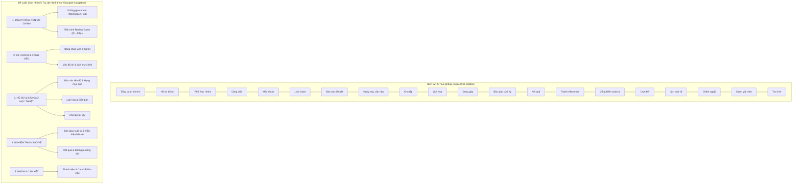

# KẾ HOẠCH CẢI THIỆN TRẢI NGHIỆM NGƯỜI DÙNG & TỐI ƯU HÓA WORKSPACE
## DỰ ÁN AI-PMS — WORKSPACE REDESIGN & IMPLEMENTATION PLAN

> **Tài liệu**: WORKSPACE_IMPROVEMENT_PLAN.md  
> **Phiên bản**: 1.0  
> **Hệ thống**: AI-PMS Frontend (`ai-pms-frontend`)  
> **Nhánh Git**: `feat/uiux-master-redesign`  
> **Kế thừa từ**: `docs/ux/WORKSPACE_UX_AUDIT.md`

---

### MỤC LỤC
1. [Mục tiêu Cải tiến & Nguyên tắc Thiết kế](#1-mục-tiêu-cải-tiến--nguyên-tắc-thiết-kế)
2. [Tái cấu trúc Kiến trúc Thông tin (Information Architecture Redesign)](#2-tái-cấu-trúc-kiến-trúc-thông-tin-information-architecture-redesign)
3. [Kế hoạch Cải tiến Chi tiết Từng Không gian Làm việc](#3-kế-hoạch-cải-tiến-chi-tiết-từng-không-gian-làm-việc)
   - [A. Tối ưu Không gian Sinh viên (Student Workspace)](#a-tối-ưu-không-gian-sinh-viên-student-workspace)
   - [B. Tối ưu Không gian Cán bộ Bộ môn (Department Staff Workspace)](#b-tối-ưu-không-gian-cán-bộ-bộ-môn-department-staff-workspace)
   - [C. Tối ưu Không gian Giảng viên Hướng dẫn (Primary Supervisor Workspace)](#c-tối-ưu-không-gian-giảng-viên-hướng-dẫn-primary-supervisor-workspace)
   - [D. Tối ưu Không gian Giảng viên Thẩm định (Evaluator / Reviewer Workspace)](#d-tối-ưu-không-gian-giảng-viên-thẩm-định-evaluator--reviewer-workspace)
4. [Danh mục Thành phần Dùng chung & Thiết kế Tương tác (Reusable Components)](#4-danh-mục-thành-phần-dùng-chung--thiết-kế-tương-tác-reusable-components)
5. [Lộ trình Triển khai Phân cấp Ưu tiên (P0 / P1 / P2 Backlog)](#5-lộ-trình-triển-khai-phân-cấp-ưu-tiên-p0--p1--p2-backlog)
6. [Quản trị Rủi ro & Tiêu chí Nghiệm thu (Acceptance Criteria)](#6-quản-trị-rủi-ro--tiêu-chí-nghiệm-thu-acceptance-criteria)

---

### 1. MỤC TIÊU CẢI TIẾN & NGUYÊN TẮC THIẾT KẾ

#### Mục tiêu Cốt lõi:
1. **Giảm tải nhận thức (Cognitive Load Reduction)**: Gom nhóm thanh điều hướng từ 20 mục rời rạc thành các nhóm chức năng mạch lạc theo hành trình người dùng.
2. **Minh bạch trạng thái học thuật & Khóa cản trở (State & Blocker Visibility)**: Người dùng ngay khi mở trang chủ phải trả lời được 3 câu hỏi:
   - Đồ án đang ở giai đoạn/Gate nào?
   - Có việc gì đang quá hạn hoặc bị từ chối cần khắc phục ngay hôm nay?
   - Hành động tiếp theo là gì, ai chịu trách nhiệm thực hiện?
3. **Phân định rõ ràng Thẩm quyền (Authority Boundary)**:
   - Trưởng nhóm (Leader) nộp bài vs Thành viên (Member) chỉ xem.
   - Giảng viên hướng dẫn (Tư vấn, định hướng) vs Hội đồng thẩm định (Ký duyệt, đánh giá).
   - Thẩm định đề cương ban đầu vs Thẩm định tiến trình các đợt Review Gates vs Chấm điểm bảo vệ cuối kỳ.
4. **Bảo toàn 100% URL hiện có**: Không xóa các route hợp lệ để tránh vỡ bookmark và deep links của người dùng.

---

### 2. TÁI CẤU TRÚC KIẾN TRÚC THÔNG TIN (INFORMATION ARCHITECTURE REDESIGN)

#### A. So sánh Cấu trúc Sidebar Sinh viên (Student Navigation)

#### B. So sánh Cấu trúc Cán bộ Bộ môn (Department Staff Navigation)

Phân chia rõ 5 giai đoạn vòng đời học vụ:
1. **Thiết lập & Chính sách (Academic Setup)**:
   - Học kỳ & Kỳ đồ án (`/academic/governance`)
   - Mẫu đợt Review Gates (`/academic/review-gates`) ⭐
   - Bộ tiêu chí Rubric đánh giá (`/academic/rubrics`)
2. **Khởi động & Phê duyệt (Inception & Approvals)**:
   - Quản lý đề tài (`/department/topics`)
   - Thẩm định đề cương đồ án (`/department/projects/review`)
   - Điều kiện sinh viên tham gia (`/department/student-qualifications`)
3. **Giám sát & Nguồn lực (Execution & Monitoring)**:
   - Ma trận tiến trình Review Gates (`/department/projects/progress-matrix`) ⭐
   - Danh mục đồ án quản lý (`/department/portfolio`)
   - Phân công Giảng viên hướng dẫn (`/department/supervisors`)
4. **Nghiệm thu & Đánh giá (Final Evaluation)**:
   - Báo cáo chấm nguội theo ngành (`/department/cold-templates`)
   - Phân công hội đồng chấm điểm (`/department/projects/:id/evaluators`)
   - Đồ án lưu trữ (`/department/projects/archived`)

---

### 3. KẾ HOẠCH CẢI TIẾN CHI TIẾT TỪNG KHÔNG GIAN LÀM VIỆC

#### A. Tối ưu Không gian Sinh viên (Student Workspace)
1. **Trang chủ Phối hợp nhóm (`CollaborationWorkspace.tsx`)**:
   - **Bổ sung Banner Tiến trình Review Gates**: Hiển thị rõ ngay đầu trang trạng thái đợt thẩm định hiện tại (ví dụ: `Đợt hiện tại: Review 2 - Hạn chót 18/10: Cần chỉnh sửa minh chứng SDD`).
   - Có nút CTA trực tiếp: **"Xem chi tiết & Nộp bản sửa →"** dẫn thẳng tới `/project/timeline`.
   - Đối với Member: Hiển thị ghi chú: *"Trưởng nhóm [Tên Leader] chịu trách nhiệm nộp bản cập nhật trước hạn chót."*
2. **Trang Dòng thời gian Review Gate (`StudentReviewTimeline.tsx`)**:
   - Đã có timeline stepper, chi tiết tiêu chí, hiển thị phiên bản minh chứng và lý do bị chặn.
   - Cải thiện hiển thị: Nêu bật các minh chứng bắt buộc (`isMandatory`) đang có cảnh báo từ chối bằng khung viền cảnh báo nổi bật.

#### B. Tối ưu Không gian Cán bộ Bộ môn (Department Staff Workspace)
1. **Trang Dashboard Bộ môn (`DepartmentWorkspacePage.tsx`)**:
   - **Bổ sung 2 Lối tắt Trọng yếu**: Thêm card trực tiếp tới:
     - `Chính sách Review Gates` (`/academic/review-gates`)
     - `Ma trận Tiến độ Đồ án` (`/department/projects/progress-matrix`)
   - **Bổ sung Metric Card**: Thêm card chỉ số: **"Đồ án cần thẩm định Gate"** bên cạnh các chỉ số "Chờ thẩm định đề cương" hiện có.
   - **Tách bạch phần Thẩm định**: Đổi nhãn "Thẩm định học vụ" thành "Thẩm định đề cương ban đầu" để tránh nhầm lẫn với các đợt Review Gates trong kỳ.

#### C. Tối ưu Không gian Giảng viên Hướng dẫn (Primary Supervisor Workspace)
1. **Trang Quản lý Hướng dẫn (`LecturerWorkspacePage.tsx`)**:
   - **Bổ sung Tín hiệu Review Gate trên từng Card Đồ án**: Thêm huy hiệu trạng thái Gate (ví dụ: `R1: ĐẠT`, `R2: CẦN SỬA`, `R3: CHỜ XỬ LÝ`).
   - **Bổ sung Nút tác vụ nhanh**: Thêm link **"Tiến trình Gate"** dẫn tới trang Dòng thời gian của đồ án để GVHD có thể mở ngay panel hướng dẫn (`SupervisorGateFollowupPanel`).

#### D. Tối ưu Không gian Giảng viên Thẩm định (Evaluator / Reviewer Workspace)
1. **Đồng bộ Hàng đợi Thẩm định**:
   - Bổ sung tab chuyển đổi nhanh trên trang Evaluator giữa:
     - Tab 1: **"Thẩm định Review Gates trong kỳ"** (`/review/gate-assignments`)
     - Tab 2: **"Chấm điểm Hội đồng & Rubric cuối kỳ"** (`/evaluator/workspace`)
   - Tránh việc Reviewer phải tìm kiếm đường link phân công ở nhiều nơi.

---

### 4. DANH MỤC THÀNH PHẦN DÙNG CHUNG & THIẾT KẾ TƯƠNG TÁC (REUSABLE COMPONENTS)

1. **`ReviewGateStatusBadge`**: Huy hiệu trạng thái Gate chuẩn hóa màu sắc:
   - `PASSED`: Xanh lục (`emerald-50`, viền `emerald-200`, text `emerald-700`).
   - `REVISION_REQUIRED`: Đỏ hồng (`rose-50`, viền `rose-200`, text `rose-700`).
   - `IN_REVIEW`: Xanh dương (`blue-50`, viền `blue-200`, text `blue-700`).
   - `PLANNED` / `BLOCKED`: Xám/Hổ phách (`amber-50` hoặc `slate-100`).
2. **`ReviewGateProgressBanner`**: Banner thông tin hiển thị trên đầu trang Workspace của Sinh viên và GVHD, thông báo tóm tắt đợt Gate hiện tại và số ngày còn lại đến hạn chót.
3. **`BlockingReasonAlert`**: Khung cảnh báo danh sách các lý do cản trở đồ án chuyển sang Gate tiếp theo hoặc điều kiện bảo vệ.

---

### 5. LỘ TRÌNH TRIỂN KHAI PHÂN CẤP ƯU TIÊN (P0 / P1 / P2 BACKLOG)

| Mức độ ưu tiên | Hạng mục thực hiện | Mục tiêu & Giá trị mang lại | Trạng thái |
| :---: | :--- | :--- | :---: |
| **P0** | **Cập nhật Lối tắt & Chỉ số Dashboard Bộ môn (`DepartmentWorkspacePage.tsx`)** | Giúp Cán bộ bộ môn phát hiện ngay và truy cập 1-click vào Chính sách Review Gates & Ma trận Tiến độ. | **Sẵn sàng triển khai** |
| **P0** | **Tích hợp Banner Trạng thái Review Gate vào Workspace Sinh viên (`CollaborationWorkspace.tsx`)** | Giúp sinh viên nắm ngay đợt Gate hiện tại, deadline và minh chứng cần nộp ngay khi mở ứng dụng. | **Sẵn sàng triển khai** |
| **P0** | **Bổ sung Tín hiệu Review Gate & Lối tắt vào Workspace GVHD (`LecturerWorkspacePage.tsx`)** | Giúp GVHD biết ngay đồ án nào đang bị tắc ở Review Gate để vào hướng dẫn hỗ trợ sinh viên kịp thời. | **Sẵn sàng triển khai** |
| **P1** | **Tối ưu hóa Phân nhóm Menu Sidebar (`workspace-route-registry.ts`)** | Nhóm gọn 20 mục sidebar của sinh viên thành các nhóm chức năng có thể mở rộng/thu gọn, giảm tải thị giác. | **Sẵn sàng triển khai** |
| **P1** | **Tích hợp Tab chuyển đổi Reviewer / Evaluator Workspace** | Kết nối mượt mà giữa hàng đợi thẩm định tiến trình Gate và hàng đợi chấm điểm đồ án. | **Kế hoạch tiếp theo** |
| **P2** | **Tinh chỉnh Vi tương tác, Phím tắt & Hoạt họa chuyển trạng thái** | Tối ưu hóa animation chuyển tab, focus trap, và thông báo nổi (toast notifications). | **Kế hoạch tiếp theo** |

---

### 6. QUẢN TRỊ RỦI RO & TIÊU CHÍ NGHIỆM THU (ACCEPTANCE CRITERIA)

1. **Không phá vỡ URL hiện hữu (Zero Route Regressions)**:
   - Toàn bộ 20 route của Sinh viên, 12 route của Bộ môn và các route GVHD vẫn truy cập bình thường, không làm hỏng deep link từ email hay thông báo.
2. **Không vi phạm Design Tokens**:
   - Tất cả text kích thước >= 12px (`text-xs`), sử dụng bảng màu Tailwind v4 chuẩn. Test `npm test -- src/test/design-tokens.test.ts` phải pass 100%.
3. **Bảo toàn Tính toàn vẹn Phân quyền**:
   - Member không thể thực hiện các thao tác của Leader.
   - GVHD không thể cho điểm thay Reviewer.
   - Cán bộ bộ môn liên ngành chỉ duyệt phạm vi ngành mình phụ trách.
4. **Kiểm thử Toàn diện**:
   - Toàn bộ bộ test Vitest hiện có (`ReviewGateGovernancePage`, `StudentReviewTimelinePage`, `AssignedGateReviewPage`, `CrossRoleScenario`) tiếp tục pass 100%.
   - Lệnh `npm run build` (`tsc -b && vite build`) hoàn thành với exit code 0.
