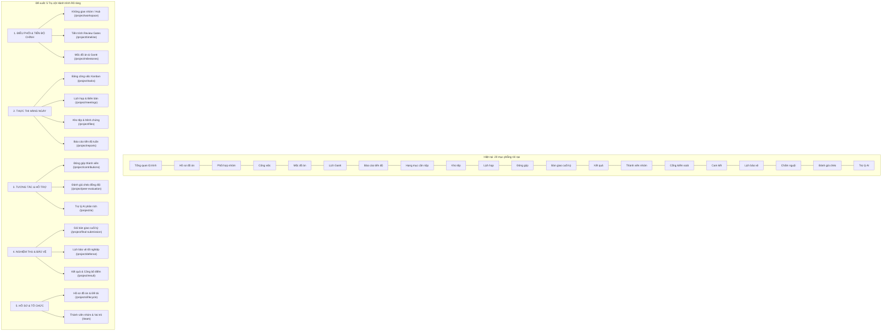

# KẾ HOẠCH TÁI THIẾT KẾ & TỐI ƯU HÓA TOÀN BỘ WORKSPACE (WORKSPACE REDESIGN PLAN)

**Hệ thống:** AI-PMS (Academic Capstone Project Management System)  
**Nhánh Git:** `feat/uiux-master-redesign`  
**Phiên bản:** 2.0 (Toàn diện hệ thống)  
**Ngày phát hành:** 2026-10-18  
**Tác giả:** Senior Product Designer, UX Architect & Academic BA  
**Kế thừa trực tiếp từ:** [`docs/ux/MASTER_WORKSPACE_AUDIT.md`](file:///f:/AI-PMS/ai-pms-frontend/docs/ux/MASTER_WORKSPACE_AUDIT.md)  

---

## 1. MỤC LỤC
1. [Triết lý Thiết kế Cốt lõi & Mục tiêu Cải tiến](#1-triết-lý-thiết-kế-cốt-lõi--mục-tiêu-cải-tiến)
2. [Tái cấu trúc Kiến trúc Điều hướng (Information Architecture Redesign)](#2-tái-cấu-trúc-kiến-trúc-điều-hướng-information-architecture-redesign)
   - 2.1. Tối ưu Sidebar Sinh viên (5 Trụ cột Hành trình)
   - 2.2. Tối ưu Sidebar Giáo vụ & Giảng viên
   - 2.3. Nguyên tắc Bảo toàn Tuyệt đối 100% URL Hiện có
3. [Phương án Tái thiết kế Chi tiết Từng Không gian Làm việc](#3-phương-án-tái-thiết-kế-chi-tiết-từng-không-gian-làm-việc)
   - 3.1. Cải tiến Department Staff Workspace (Tách rời Cấu hình & Vận hành)
   - 3.2. Cải tiến Student Workspace (Hub Hành trình & Hộp thoại Cổng Thẩm định)
   - 3.3. Cải tiến Supervisor Workspace (Action-Oriented Dashboard)
   - 3.4. Cải tiến Reviewer Workspace (Tập trung Thẩm định & Minh chứng)
4. [Bộ Thành phần Giao diện Chuẩn hóa Dùng chung (Shared UI Patterns)](#4-bộ-thành-phần-giao-diện-chuẩn-hóa-dùng-chung-shared-ui-patterns)
5. [Lộ trình Triển khai Phân cấp Ưu tiên (Backlog P0 / P1 / P2)](#5-lộ-trình-triển-khai-phân-cấp-ưu-tiên-backlog-p0--p1--p2-backlog)

---

## 1. TRIẾT LÝ THIẾT KẾ CỐT LÕI & MỤC TIÊU CẢI TIẾN

### Phong cách Thiết kế:
**Modern Minimalist · Clean Academic SaaS · Functional First · Consistent · Accessible**

- **Gọn gàng, chuẩn mực đại học:** Màu sắc trung tính, tinh tế (Slate/Zinc làm nền), màu nhận diện thương hiệu học thuật rõ ràng (Primary Navy `#1e3a8a`, Academic Emerald `#059669`, Warning Amber `#d97706`, Error Rose `#e11d48`).
- **Phân cấp thị giác rõ ràng:** Tiêu đề trang $\ge 20\text{px}$, tiểu mục $14\text{px}$, nhãn/chú thích $\ge 12\text{px}$ (`text-xs`). Tuyệt đối không dùng chữ siêu nhỏ $< 12\text{px}$.
- **Tránh trang trí dư thừa:** Bỏ các hiệu ứng gradient rối mắt, shadow đa tầng và modal lồng modal. Thay vào đó, dùng cấu trúc Drawer bên phải cho tác vụ ngữ cảnh và Page riêng cho quy trình nhiều bước.
- **Minh bạch trạng thái học thuật & Khóa cản trở:** Khi nút bấm bị mờ (disabled), hệ thống **bắt buộc phải hiển thị lý do vì sao bị vô hiệu hóa** và hướng dẫn người dùng cần làm gì để mở khóa.

---

## 2. TÁI CẤU TRÚC KIẾN TRÚC ĐIỀU HƯỚNG (INFORMATION ARCHITECTURE REDESIGN)

### 2.1. Tối ưu Sidebar Sinh viên (5 Trụ cột Hành trình)
Hiện tại Sidebar sinh viên liệt kê 20 mục phẳng rời rạc. Đề xuất nhóm lại thành 5 nhóm có tiêu đề rõ ràng, giúp giảm 70% tải nhận thức (Cognitive Load):

### 2.2. Tối ưu Sidebar Giáo vụ & Giảng viên
- **Department Staff:** Phân nhóm thành:
  1. *Điều hành Đồ án (Operations):* Ma trận tiến độ Gates (`/department/projects/progress-matrix`), Thẩm định đề cương (`/department/projects/review`), Danh mục đồ án (`/department/portfolio`).
  2. *Nguồn lực & Nhân sự (Resources):* Giảng viên hướng dẫn (`/department/supervisors`), Đề tài (`/department/topics`), Điều kiện sinh viên (`/department/student-qualifications`).
  3. *Cấu hình & Quy chế (Academic Setup):* Chính sách Review Gates (`/academic/review-gates`), Học kỳ & Kỳ đồ án (`/academic/governance`), Tiêu chí Rubric (`/academic/rubrics`).
- **Lecturer / Supervisor:** Phân nhóm thành:
  1. *Hướng dẫn Đồ án:* Tổng quan hướng dẫn (`/supervisor/dashboard`), Không gian đồ án phụ trách (`/supervisor/workspace`).
  2. *Thẩm định & Chấm thi:* Thẩm định Review Gates (`/review/gate-assignments`), Hội đồng chấm bảo vệ (`/evaluator/workspace`).
  3. *Hồ sơ cá nhân:* Hồ sơ giảng viên & Hạn mức (`/supervisor/profile`).

### 2.3. Nguyên tắc Bảo toàn Tuyệt đối 100% URL Hiện có
- Tất cả các đường dẫn URL (`/project/*`, `/department/*`, `/supervisor/*`, `/admin/*`) **được giữ nguyên vẹn 100%**.
- Việc nhóm lại thanh điều hướng được thực hiện qua thuộc tính `section` và `group` trong `workspace-route-registry.ts` mà không làm thay đổi hay gỡ bỏ bất kỳ route nào, đảm bảo không làm đứt gãy bookmark hoặc liên kết từ thông báo hệ thống.

---

## 3. PHƯƠNG ÁN TÁI THIẾT KẾ CHI TIẾT TỪNG WORKSPACE

### 3.1. Cải tiến Department Staff Workspace (`DepartmentWorkspacePage.tsx`)
- **Trước cải tiến:** 11 liên kết ngang hàng trong một khung lưới màu xám, người dùng không biết việc gì cần làm gấp, việc gì là cấu hình định kỳ một lần mỗi năm.
- **Sau cải tiến (Bố cục 3 Phân tầng):**
  1. **Tầng 1 — Việc cần xử lý ngay (Urgent Action Queue):**
     - Đề cương đăng ký mới cần duyệt (Badge số lượng đỏ/cam, click mở trực tiếp hồ sơ).
     - Đồ án đang bị kẹt hoặc có báo cáo trễ hạn (Signals attention).
     - Cổng thẩm định chưa phân công thẩm định viên.
  2. **Tầng 2 — Giám sát Tiến trình Học vụ (Progress Monitoring Hub):**
     - Card lớn dẫn vào **Ma trận Tiến độ Review Gates** với tỷ lệ hoàn thành theo ngành (IT: 4 gates, Biz: 3 gates).
     - Bộ lọc nhanh theo Học kỳ và Chuyên ngành.
  3. **Tầng 3 — Quản trị Cấu hình & Quy chế (Academic Configuration):**
     - Nhóm riêng các liên kết: Thiết lập Học kỳ, Mẫu tiến trình Cổng thẩm định theo ngành, Bộ tiêu chí Rubric.

### 3.2. Cải tiến Student Workspace (`ActiveProjectWorkspacePage.tsx` & `StudentReviewTimeline.tsx`)
- **Trước cải tiến:** Sinh viên vào `ActiveProjectWorkspacePage` chỉ thấy danh sách task Kanban, muốn biết Review Gate đang ở đâu phải bấm sang trang Timeline khác.
- **Sau cải tiến (Integrated Hub):**
  1. **Next Action Banner (Đỉnh trang):**
     - Hiển thị Cổng thẩm định đang kích hoạt (`Active Review Gate`).
     - Nếu trạng thái là `REVISION_REQUIRED`: Banner màu hổ phách cảnh báo: *"Reviewer yêu cầu chỉnh sửa kiến trúc phần mềm trước ngày 25/10. Xem nhận xét và nộp lại bản v2 tại đây."* (Nút bấm mở thẳng Modal nộp bài).
     - Nếu trạng thái là `WAITING_REVIEW`: Banner màu xanh dương thông báo: *"Đã nộp minh chứng v1 ngày 17/10. Đang chờ thẩm định viên xác nhận."*
  2. **Thẻ 4 Chỉ số KPI Chuẩn hóa:**
     - *Tiến độ học vụ (Chỉ tính cổng đã PASS):* $100 \times \frac{\sum W_{\text{passed}}}{W_{\text{total}}}\%$.
     - *Tiến độ công việc (Task Board):* Độc lập hoàn toàn, không nhầm lẫn với kết quả cổng.
     - *Cổng hiện tại:* Tên cổng và hạn chót.
     - *Điều kiện bảo vệ (Advisory):* Danh mục kiểm tra tư vấn, không tự ý khóa cổng cuối khi chưa có quyết định của Khoa.

### 3.3. Cải tiến Supervisor Workspace (`SupervisorDashboardPage.tsx`)
- **Trước cải tiến:** Dashboard hiển thị 4 số đo và bảng danh sách đồ án. Giảng viên muốn duyệt báo cáo tuần phải click vào từng đồ án, mở menu con `Báo cáo tiến độ`, rồi mới bấm duyệt.
- **Sau cải tiến (Action Inbox):**
  - Bổ sung tab/khối **"Hộp thư duyệt nhanh (Quick Review Inbox)"** ngay trên Dashboard:
    - Liệt kê các báo cáo tiến độ định kỳ mới nộp của các nhóm.
    - Cho phép giảng viên xem bản tóm tắt, nhập nhận xét và bấm "Xác nhận báo cáo" trực tiếp mà không cần chuyển trang 3 lần.

### 3.4. Cải tiến Reviewer Workspace (`AssignedGateReviewPage.tsx`)
- **Trước cải tiến:** Đã được thiết kế tốt ở Phase 2, nhưng cần hoàn thiện:
  - Hiển thị rõ lịch sử các lần nộp (Submission History v1, v2) kèm ghi chú của sinh viên.
  - Phân tách rõ: Minh chứng nào đã `ACCEPTED`, minh chứng nào còn `PENDING` hoặc `REJECTED`.
  - Khóa nút "Phê duyệt ĐẠT cổng" kèm tooltip: *"Chưa thể duyệt ĐẠT vì còn 1 minh chứng bắt buộc chưa được chấp thuận."*

---

## 4. BỘ THÀNH PHẦN GIAO DIỆN CHUẨN HÓA DÙNG CHUNG (SHARED UI PATTERNS)

Để đảm bảo tính nhất quán trên toàn bộ hệ thống, chúng ta chuẩn hóa 5 component cốt lõi:

| Thành phần (Component) | Vị trí / Mục đích sử dụng | Hành vi nghiệp vụ & Trạng thái |
|---|---|---|
| **`ActionGuardButton`** | Thay thế các nút Submit / Approve bị disable xám | Luôn hiển thị tooltip hoặc popover giải thích rõ lý do bị khóa và điều kiện tiên quyết cần hoàn thành để kích hoạt nút. |
| **`NextActionBanner`** | Đỉnh trang của Student Hub và Supervisor Hub | Trả lời ngay lập tức câu hỏi: *"Tôi cần làm gì tiếp theo hôm nay? Ai đang chờ tôi xử lý?"* |
| **`AcademicProgressCard`** | Trang tổng quan đồ án và giám sát bộ môn | Hiển thị song song 2 thanh đo: **Tiến độ Học vụ (Cổng đã duyệt)** và **Tiến độ Task kỹ thuật (Khối lượng công việc)**. |
| **`EvidenceLedgerTable`** | Màn hình nộp bài sinh viên và màn hình thẩm định viên | Quản lý minh chứng theo phiên bản bất biến (v1, v2, v3), mã hóa trạng thái minh chứng (`PENDING`, `ACCEPTED`, `REJECTED`). |
| **`AdvisoryReadinessModal`** | Kiểm tra điều kiện bảo vệ cuối kỳ | Liệt kê các điều kiện tiên quyết (Cổng đạt, Báo cáo nộp đủ, Chữ ký GVHD). Hiển thị ranh giới tư vấn rõ ràng. |

---

## 5. LỘ TRÌNH TRIỂN KHAI PHÂN CẤP ƯU TIÊN (BACKLOG P0 / P1 / P2)

### Ưu tiên P0 — Cốt lõi & Tác động Trực tiếp đến Trải nghiệm Người dùng (Sprint 1)
- **P0.1:** Tái cấu trúc nhóm điều hướng Sidebar Sinh viên từ 20 mục phẳng thành 5 Trụ cột mạch lạc trong `workspace-route-registry.ts` và `Sidebar.tsx`.
- **P0.2:** Tích hợp `NextActionBanner` vào `CollaborationWorkspace.tsx` và `ActiveProjectWorkspacePage.tsx` hiển thị trạng thái Review Gate trực tiếp cho sinh viên.
- **P0.3:** Tái cấu trúc `DepartmentWorkspacePage.tsx` theo 3 tầng (Việc cần xử lý ngay, Giám sát Gates, Cấu hình chính sách).
- **P0.4:** Áp dụng `ActionGuardButton` cho màn hình nộp bài và duyệt cổng để không còn nút xám câm lặng.

### Ưu tiên P1 — Nâng cao Hiệu quả Vận hành (Sprint 2)
- **P1.1:** Xây dựng Hộp thư duyệt nhanh (Action Inbox) trên `SupervisorDashboardPage.tsx`.
- **P1.2:** Hoàn thiện bảng phân nhóm tiến độ đa ngành song song trên chế độ xem của Mentor và Department Staff.
- **P1.3:** Tối ưu hóa bảng danh mục tài khoản Admin (`AdminWorkspacePage.tsx`) hiển thị tên ngành/bộ môn thay vì ID số.

### Ưu tiên P2 — Tinh chỉnh Thẩm mỹ & Tương tác Nâng cao (Sprint 3)
- **P2.1:** Tinh chỉnh chuyển động vi mô (Micro-interactions) mượt mà cho các tab và accordion theo chuẩn Motion Design.
- **P2.2:** Tối ưu hóa khả năng co giãn trên màn hình Mobile 375px cho các bảng ma trận phức tạp.
